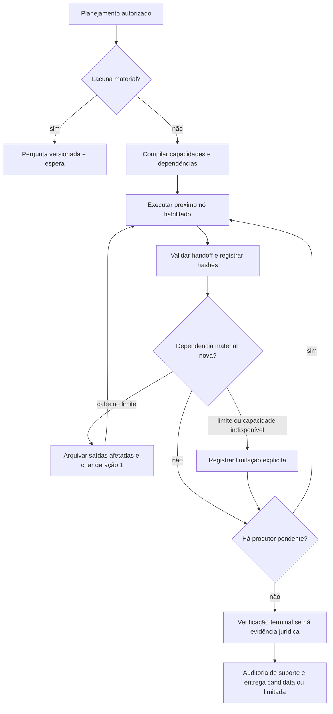

# ForgeLex 3 — incremento 2: orquestração adaptativa nativa

Implementação local em `codex/forgelex-3-quality`, sobre os incrementos anteriores
não commitados. Pedido de Boni: implementar o grafo adaptativo, preservar os
controles atuais e validar localmente. Não houve inferência paga, migration
remota, commit, push, merge ou publicação.

## Comportamento implementado

Novos trabalhos usam estado v2. O plano é compilado pelo servidor em capacidades
com IDs, dependências, geração e status explícitos. Os especialistas podem
solicitar quatro capacidades fechadas: pesquisa jurisprudencial, pesquisa
normativa, análise processual e revisão adversarial. Os pedidos incluem motivo
enumerado, questões do plano e fontes existentes. Não escolhem ação diferente,
provider, preço, ferramenta externa ou permissão. Conflito explícito descoberto
na análise ativa revisão mesmo quando o plano original não a previa.

Uma dependência tardia pode gerar um único ciclo de refinamento. Resultados
concluídos que dependiam da entrada anterior são arquivados por ID e hash;
os descendentes recebem nova geração. A entrega e a auditoria de suporte usam
somente as saídas ativas. A minuta anterior não é reapresentada como se tivesse
incorporado a pesquisa posterior. O verificador continua terminal e não pode
produzir novas afirmações, requisitos, documentos ou pedidos de capacidade.

O DAG é executado serialmente pelo journal existente. Dependências conservadoras
preservam a ordem análise → pesquisa → procedimento → redação → revisão →
verificação entre os papéis selecionados. Não há paralelismo novo nem framework
externo. A adaptação está na seleção, expansão limitada e invalidação explícita.

## Limites e controles

- Um ciclo de replanejamento e dez execuções de papéis, incluindo planejamento.
  A expansão é recusada antes de invalidar resultados quando as etapas restantes
  não cabem no limite. Uma limitação explícita acompanha a geração consistente.
- Permanecem 48 ferramentas por trabalho, 12 por etapa, 192.000 bytes de
  estado/entrega, 24 chamadas comerciais, 2.048 tokens de saída por chamada,
  teto financeiro e prazos existentes. O limite de papéis não autoriza consumo
  acima do orçamento de inferência.
- Fontes/ferramentas indisponíveis não causam repetição automática. A falha é
  registrada por operação: jurisprudência indisponível não impede consulta
  normativa independente quando a ferramenta normativa foi injetada. A
  composição comercial segue apenas com STJ; nenhuma ferramenta normativa foi
  habilitada por este incremento.
- O manifesto de ferramentas é fixado no checkpoint. Mudança na retomada é
  recusada. Os guards de usuário, tenant, caso, seleção, cancelamento, reserva
  e chamadas incertas permanecem nos caminhos existentes.
- Estado sem plano após planejamento, dependências alteradas, saída com hash
  divergente e verificador pulado com fonte jurídica são recusados antes de
  prosseguir. Cada nó conserva snapshot compacto verificável da entrada.
- Novos códigos canônicos `CAPABILITY_UNAVAILABLE`, `DEPENDENCY_UNRESOLVED`,
  `ORCHESTRATION_REPLAN_LIMIT` e `ORCHESTRATION_NODE_LIMIT` são limitações; não
  contam isoladamente como trabalho utilizável para cobrança.

Os detalhes de grafo ficam no checkpoint interno. A entrega conserva
`legalAssessment: NOT_EVALUATED` e revisão humana obrigatória; a interface
não ganhou um painel operacional ou alegações de qualidade jurídica.

## Compatibilidade

A fixture `pre-graph-v1.json` foi capturada executando o build anterior, antes
da alteração do runtime, com provider falso. O contrato v1 do incremento 1
(policy/perfis 1.2.0, hash `d097ba9f837fd4a6b89c97baf3e2baa632949482e505f21e6ba42f0b25860888`)
retoma pelo algoritmo sequencial original, sem repetir o planejador.
Contratos mais antigos que já eram incompatíveis continuam rejeitados; não foi
criada migração silenciosa ou suporte universal a toda versão histórica.

Estado v2 usa policy/perfis 1.3.0 e output contract 5. A sequência de chamadas
permanece monotônica pelo número de papéis executados, integrada ao journal
existente. Uma imagem antiga só v1 não lê os novos checkpoints: uma futura
publicação/rollback deve drenar ou separar trabalhos por versão. Nenhuma
operação produtiva foi realizada.

## Comparação e validação

A [comparação determinística](evidence/2026-11-01-adaptive-graph-comparison.json)
usa o mesmo contexto, plano e respostas sintéticas por papel. No cenário de
conflito descoberto após o planejamento, o fluxo v1 termina após dois papéis;
o v2 ativa um terceiro papel de revisão e conserva a limitação identificada.
Isso prova mudança de roteamento e controle, com uma etapa adicional, sem
medir qualidade semântica, latência ou custo de modelo real.

Os testes cobrem também falta parcial de ferramentas, pedido misto com uma
operação indisponível e outra disponível, invalidação de minuta/revisão,
limite de refinamento, orçamento de papéis, revogação, cancelamento,
checkpoint inconsistente e entrega única. A integração comercial usa SDK e
SSE sintético e mantém uma reserva, sem cobrança avulsa da pesquisa.

Resultados finais, comandos, limitações e hashes estão no
[recibo de validação](evidence/2026-11-01-adaptive-graph-validation.json).
As regressões encontradas durante a revisão foram reproduzidas antes dos fixes;
a revisão focal posterior aprovou 28 testes e não identificou novo achado
acionável. A revisão de IA apoia Boni, único avaliador/aprovador humano.

| Verificação local | Resultado |
| --- | --- |
| Suíte geral Vitest | 1.491 aprovados, zero falhas, 17 condicionais pulados |
| Rodada PostgreSQL | 41 aprovados; cobre 16 dos condicionais da suíte geral |
| Grafo e integração comercial focais | 28 aprovados |
| Smoke PostgreSQL entre processos | 13 checks aprovados |
| E2E comercial Chromium | Um cenário aprovado, 29,6 segundos |
| Build, tipos, lint e formatação pertinente | Aprovados |

Resta sem execução a homologação com provider real, que envolve inferência
paga. As contagens das rodadas se sobrepõem e não devem ser somadas como testes
distintos. O smoke foi ampliado com uma nova entrega adaptativa; sua asserção
de concorrência passou a contar por execução, mantendo a exigência de uma
única entrega. A retomada após invalidação ocorreu em outro processo sem
repetir nós concluídos; a conferência de edição humana também passou.

## Arquivos e próximos incrementos

Contratos/perfis adaptativos em `packages/legal-agents/src/agentic-case-graph.ts`;
compilação, dependências e reconciliação em `orchestration-graph.ts`; integração
e seleção v1/v2 em `case-task.ts`. Testes e fixture históricos no mesmo pacote;
integração comercial e smoke PostgreSQL ampliados nos caminhos existentes.
Sem alteração de preços, schema de banco, dependências, ferramentas comerciais
permitidas ou novas categorias de tarefa.

A próxima frente do programa é a capacidade jurídica probatória completa.
Avaliação semântica comparativa com modelo real e publicação permanecem
separadas. Este incremento não declara concluído todo o programa ForgeLex 3.0.
