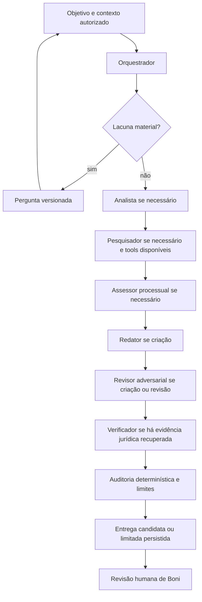

# ForgeLex 3.0 — auditoria e primeiro incremento vertical

Data: 01/11/2026. Baseline: `025f6dd438ecfd78079b4688fd076e476da74ce9`,
confirmado por `git ls-remote origin refs/heads/main`. Branch local:
`codex/forgelex-3-quality`. O checkout original, com alterações de outra frente,
foi preservado. Este documento descreve código e testes locais, não produção.

**Atualização posterior na mesma data:** as pendências de integração da pesquisa
comercial e da fixture SQLite foram tratadas no
[complemento local](2026-11-01-forgelex-3-pending-local.md). Os resultados abaixo
registram o estado ao encerrar o primeiro incremento, antes desse complemento.

## Resultado e fronteira de entrega

O primeiro incremento fecha lacunas de integridade entre especialistas e conserva
a evidência da conferência na entrega. A comparação determinística passou de
30/60 para 60/60 cenários com o mesmo provider falso, fontes e critérios.
Isso mede execução de controles; não demonstra melhoria semântica de um LLM.
Não há alegação de excelência jurídica, homologação real ou conclusão de todo
o programa ForgeLex 3.0. Grafo adaptativo completo e nova categoria de tarefa
jurídica ainda não foram implementados.

Não houve commit, push, merge, deploy, migração remota, operação financeira real,
nova infraestrutura ou chamada paga. Os preços e limites citados abaixo são
configuração observada no código, não recomendação comercial nem confirmação
da configuração produtiva.

## Reconstrução do fluxo executável

1. `apps/web/src/agentic-workspace/client.ts` envia objetivo/contexto; a tela
   acompanha execução e SSE. `execution-routes.ts::registerAgenticWorkspace`
   autentica, confere flags e escolhe runtime simples, piloto ou comercial.
2. `execution-service.ts::startExecution` registra conversa/revisão, execução
   e job. Comandos são idempotentes e vinculados ao proprietário. No comercial,
   `commercial-runtime.ts::activate` reserva antes de ativar inferência.
3. `execution-worker.ts::runOnce` obtém lease, renova-o, abre journal de etapa,
   verifica cancelamento e grava checkpoint, pergunta ou conclusão. Cancelamento
   cooperativo já existe na main: termina a chamada em voo e impede nova etapa.
4. `case-task-driver.ts::createCaseTaskDriver` monta contexto nativo e ferramentas
   explicitamente disponíveis. Pesquisa usa journal/orçamento próprio quando
   injetada no driver; normativa depende de `legislationProvider` explícito.
5. `native-case-task-repository.ts::guarded` verifica tenant, usuário, execução,
   caso, revisão e seleção documental. Carrega snapshots, respostas e entregas
   anteriores elegíveis. Documentos não se tornam instruções de ferramentas.
6. `case-task.ts::step` confere hash do contrato/contexto e executa um papel por
   checkpoint. `run` monta `ToolRegistry` restrito a L0/L1, policy e schema
   de `task.submit`. A saída passa por Zod, referências e conflitos de claimId.
7. `AgentRuntime.run` delega ao provider vendor-neutral. Os adaptadores aplicam
   os contratos do SDK; o transporte comercial adicional restringe destino,
   ferramentas, bytes, tokens e contabilização do consumo.
8. `delivery` agrega resultados e limitações. `NativeCaseTaskRepository.save`
   grava JSON com hash e identidade por execução; minuta cria versão `DRAFT`.
   A rota de entrega preserva autorização do proprietário. A interface usa
   `present-delivery.ts` para texto, fontes e pendências. Aprovação/protocolo
   não decorrem dessa entrega.

### O que não se deve confundir

| Componente | Estado executável observado |
| --- | --- |
| `LEGAL_AGENT_CATALOG`, `LEGAL_ACTION_CATALOG` | Contratos históricos com `executionEnabled: false`; não são interruptor global do runtime nativo |
| `caseTaskProfile` + `AgenticCaseTask` | Sete papéis executáveis quando injetados e autorizados; orquestrador/assessor têm extensões nativas mesmo sem definição equivalente no catálogo histórico |
| `LegalContractWorkflow` | Runner com handler externo explícito; não ativa modelo automaticamente |
| `legal-research-memo-execution.ts` | Pesquisa/obtenção e síntese determinística; `compileLegalResearchMemo` enumera autoridades, sem demonstrar raciocínio jurídico multiagente |
| MCP externo | Canal existente de pesquisa/contexto/retorno autorizado; não é a mesma sessão do runtime comercial interno |
| Pesquisa no workflow nativo | Implementada e testável com `researchService`; não implica disponibilidade no transporte comercial |
| Normas | Recuperação de snapshots versionados por factory; sem catálogo normativo universal ou vigência online presumida |

## Achados, prioridade e evidência

| ID / prioridade | Classificação | Evidência e consequência |
| --- | --- | --- |
| Q1 / alta | Comprovado por regressão; corrigido | `case-task.ts::role` verificava antes de assessor/redator/revisor. No baseline, claims do redator não estavam em `priorResults` do verificador. Agora o verificador é terminal, uma vez por execução |
| Q2 / alta | Comprovado por regressão; corrigido | `delivery` usava `supportChecks.find(...)`: primeira avaliação positiva ocultava outra negativa ou duplicada. Agora um par duplicado é `CONFLICTING` e não sustenta a afirmação |
| Q3 / média | Comprovado por regressão; corrigido | `refs` validava arrays `sourceIds`, não os pares singulares de `supportChecks`. Avaliações órfãs/desvinculadas agora geram `SUPPORT_CHECK_INVALID`, sem fabricar IDs de fonte na entrega |
| Q4 / média | Comprovado por inspeção e round-trip; corrigido | `supportChecks` ficava só no checkpoint. `supportAudit` conserva hash, trecho e avaliações separadas na entrega persistida |
| Q5 / média | Comprovado em revisão e teste; corrigido | Verificador terminal podia criar afirmações/requisitos após o revisor; schema agora exige arrays vazios para esses campos |
| Q6 / média | Comprovado em revisão e teste; corrigido | Matriz de pares pode amplificar payload. Limite de 192.000 bytes é aplicado à entrega antes de `save`, além do estado/contexto |
| R1 / alta para expansão | Comprovado no código; não alterado | `commercial-runtime.ts` monta `caseTask` sem research/legislation; `execution-routes.ts` passa `undefined` para pesquisa no comercial/piloto; `provider-transport.ts::AGENT_TOOL_NAMES` só contém leitura de seleção e `task.*`. Portanto pesquisa automática comercial não está habilitada por esses caminhos |
| R2 / alta para expansão | Risco fundamentado no código | `commercial-runtime.ts::assertContext` compara `live.sources` com `packet.sources` integralmente; futura pesquisa acrescenta evidências ao packet. Só ampliar allowlist não basta: separar seleção autorizada de fontes recuperadas e integrar orçamento antes de habilitar |
| R3 / alta qualidade | Limitação comprovada; mérito não medido | `source.text.includes(quote)` confirma ocorrência literal, não entailment. `SUPPORTED` continua avaliação do modelo, explicitamente rotulada; `legalAssessment` permanece `NOT_EVALUATED` |
| R4 / média | Limitação comprovada | Requisitos usam `verified` do modelo + existência de NORM; seções usam presença de referências. Não existe validação semântica completa de requisitos/pedidos. A instrução de emitir claims ajuda, mas não prova completude |
| R5 / média | Limitação comprovada | Cobertura de questões usa IDs declarados pelo modelo. Não mede se a questão foi substantivamente respondida. Orquestrador define o universo de questões, podendo omitir uma antes da métrica |
| R6 / média | Risco de carga, sem benchmark de produção | `execution-service.ts::getExecution` ainda chama `store.atomic`; não confundir correção das varreduras de admissão com eliminação de locks de leitura |
| R7 / média | Limitação comprovada | Resposta material cria novo contexto e sucessora sem reaproveitamento integral de checkpoint. Evita reutilização indevida, mas pode repetir planejamento/inferência |
| R8 / média | Limitação de avaliação | Rubrica em `legal-evaluations.ts` contém 15 descrições, sem executor semântico. Nova bateria cobre integridade, não resolve avaliação jurídica real |

Hipóteses não demonstradas: magnitude do ganho semântico dos prompts, impacto em
latência real, cobertura jurisprudencial prática e qualidade de recomendações
processuais. Nenhum percentual de melhora nessas dimensões foi inferido.

## Reconciliação com a revisão de 30/10

O documento histórico inclui adendos; seus achados iniciais não são todos atuais.
Na main conferida há conciliação manual de chamada incerta, tolerância a falha
transitória de autenticação, recuperação de retries do SSE, pré-checagem de
admissão antes da resposta, limites considerando consumo sem cobrança, lista
canônica de limitações, logs e varredura indexada de admissões expiradas.
`.github/workflows/ci.yml` já executa os quatro smokes agênticos PostgreSQL que
antes estavam ausentes. Presença no YAML não equivale a execução local nesta tarefa.

Cancelamento cooperativo da PR #101 também já integra o baseline. Timeout ou
falha de rede ainda podem exigir conciliação. README/CONTINUIDADE/PENDENCIAS
misturam fotografias e adendos; esta auditoria não usa seus snapshots antigos
como comprovação do estado produtivo atual.

## Arquitetura-alvo e alternativas

| Alternativa | Ganho | Custo/limite | Decisão |
| --- | --- | --- | --- |
| Sequência condicional aperfeiçoada | Corrige handoffs e verificação com baixo impacto | Roteamento ainda depende de papéis fixos e booleans do plano | Implementada neste incremento |
| Grafo nativo de capacidades/dependências | Seleção por tarefa, replanejamento limitado, paralelismo de nós independentes | Exige contratos de nós, reconciliação, journal e avaliação específicos | Alvo incremental recomendado |
| LangGraph | Checkpoints, interrupções e primitivas de grafo disponíveis | Adaptação de estado/tenant/ledger; não fornece qualidade jurídica nem substitui permissões | Não adicionar sem demonstração comparativa |

As capacidades de persistência/interrupção da alternativa externa foram
conferidas na [documentação oficial do LangGraph](https://docs.langchain.com/oss/javascript/langgraph/thinking-in-langgraph).
A decisão é de engenharia deste incremento, não escolha atribuída a Boni.

Grafo executado após o incremento (arestas condicionais; sem paralelismo novo):



Não há execução paralela nem ciclo de refinamento automático nesta versão.
Cada papel custa no máximo a execução prevista anteriormente; mover o verificador
não acrescenta um segundo verificador. Os 60 cenários consumiram 315 chamadas de
ferramenta sintéticas antes e depois. Tokens/latência/custo de modelo real não
foram medidos; instruções e contexto do verificador ficaram maiores.

Para o grafo futuro: nós identificados por execução, capability e versão;
dependências explícitas; entradas por revisão/hash; resultados com questões,
claims, fontes, incertezas e pendências; decisões de roteamento registradas com
motivo público conciso, nunca cadeia de pensamento. Paralelizar apenas pesquisa
de subtarefas independentes depois de definir orçamento e merge determinístico.
Replanejamento deve ter teto e motivo material, e não repetir chamadas faturadas.

## Matriz dos sete papéis

| Papel | Alteração e responsabilidade | Tools e limites |
| --- | --- | --- |
| legal-orchestrator | Questões com origem, dependências e esclarecimentos materiais; não resolver mérito no plano | Leitura selecionada, fontes já disponíveis, submit |
| matter-analyst | Cronologia documentada; separar alegações, provas, inferências e contradições | Mesmo recorte de leitura; não confirmar fatos |
| legal-researcher | Refinamento de consulta, posições contrárias e limites de ratio/ementa | Pesquisa/obtenção/verificação STJ e snapshots normativos somente se injetados |
| procedural-advisor | Alternativas condicionais; requisitos versionados; não calcular prazo sem marcos/fontes | Normativa se disponível; sem calendário novo |
| legal-drafter | Seções e pedidos ligados a premissas; emitir claims para proposições jurídicas | Leitura; único produtor de documento candidato |
| adversarial-reviewer | Objeções e consistência narrativa/fundamentos/pedidos, com origem | Leitura; não altera nem aprova minuta |
| authority-verifier | Terminal; avalia todos os produtores, sem gerar claims/requisitos próprios | Obtenção/verificação de autoridade; uma avaliação por par, lacunas em findings |

As extensões nativas estão em `instructions/case-task.ts`, perfil/policy 1.2.0.
Os contratos históricos MCP/catalogados mantêm suas versões. Nenhum agente novo:
legislação cabe provisoriamente no assessor/pesquisador; provas no analista;
precedentes no pesquisador/verificador. Especialista adicional só se justifica
após falha residual mensurada que não caiba nessas responsabilidades. Isso evita
custo de chamadas e duplicação de análise sem evidência de benefício.

## Contratos e fontes

`TaskPlan`: ação, necessidade de pesquisa/normas/procedimento, questões, lacunas.
`TaskSpecialistResult`: cobertura declarada, claims classificados, requisitos,
findings, supportChecks e documento apenas para redator. O verifier terminal
recebe schema específico sem novos claims/requisitos.
`CaseTaskState`: outputs, evidências, perfis, operações de pesquisa, toolCount,
hash de contrato/contexto e entregas anteriores fixadas. O armazenamento é
vinculado ao proprietário; não foi criado um estado global compartilhado.

`supportAudit` é aditivo e opcional na leitura histórica. Cada entrada contém
claimId/sourceId, hash do texto, trecho quando único, `quoteStatus` e
`modelAssessment`. Não contém uma conclusão de vigência, pertinência, força
vinculante ou autenticidade. Identidade/proveniência permanece no registro da
fonte, com seus limites. Não é adicionado `verified: true` ao par.

Checks órfãos geram limitação; checks duplicados não são resolvidos por ordem.
Trecho ausente ou avaliação não positiva continuam bloqueando suporte. Uma
substring curta pode existir sem sustentar a tese: o teste explicita essa
limitação para não fabricar uma garantia semântica.

Limites preservados: 6 turns por papel, 12 tools por etapa, 48 por tarefa,
192.000 bytes de contexto/estado e agora também de entrega. No transporte
comercial: 24 chamadas, 2.048 output tokens por chamada e 300.000 ms, conforme
`COMMERCIAL_POLICY`; limites HTTP e controles financeiros continuam separados.

## Expansão jurídica: viabilidade e próximos incrementos

| Frente | Base reutilizável | Falta para capacidade completa |
| --- | --- | --- |
| A. Processual | Assessor, requisitos, snapshots normativos | Marcos/calendários verificáveis, aplicabilidade e alternativas avaliadas |
| B. Jurisprudencial | Índice STJ, search/get/verify, suporte por par | Integração comercial autorizada, estratégia iterativa avaliada, inteiro teor suficiente para ratio/distinguishing |
| C. Normativa | Catálogo/versões e seletor temporal | Cobertura homologada, metadados temporais na entrega, aplicabilidade separada da recuperação |
| D. Probatória | Documentos versionados, fatos/provas/cronologia existentes | Matriz completa questão–alegação–trecho–contradição, incorporação humana e avaliação |
| E. Estratégia | Teses e revisor adversarial | Comparação estruturada de alternativas, premissas, riscos e objeções sem probabilidades inventadas |
| F. Produção | Minuta, seções, versionamento e revisão | Suporte de todas as proposições/requisitos/pedidos, refinamento controlado e avaliação por gênero |
| G. Contratos/preventivo | Seleção documental e revisão de texto | Cláusulas, obrigações e riscos com origem; normativas pertinentes e escopo próprio homologado |

Escolha recomendada para incremento 3: matriz probatória com cronologia e
contradições, por reutilizar documentos/fatos existentes sem ampliar tribunais
ou depender de fonte externa nova. Ainda é proposta; não foi anunciada nem
habilitada como nova categoria de produto.

Ordem: (1) homologar este incremento; (2) resolver integração de ferramentas e
orçamento comercial antes de anunciar pesquisa interna; (3) grafo nativo por
capacidades com limites/reconciliação; (4) vertical probatória; (5) avaliação
semântica controlada e refinamento. Fontes congeladas continuam congeladas.

## Avaliação reproduzível

Arquivo executável: `packages/legal-workflows/src/agentic-case-task/support-benchmark.test.ts`.
São **12 padrões de handoff × 5 contextos de fonte = 60 cenários**, não 60
processos jurídicos independentes. Contextos: ementa com status oficial,
candidato não verificado, trecho truncado e duas versões normativas sintéticas.
Padrões: suporte literal, parcial, nenhum, indeterminado, ausente, trecho
fabricado, avaliações conflitantes/duplicadas, fonte/claim desconhecidos,
fonte não citada e claim tardio do redator. Todas as fronteiras serializam o
checkpoint. Fontes e avaliações são fixtures, sem rede ou conteúdo jurídico real.

Regressões complementares cobrem prompt injection sem concessão de tool,
fatos/IDs conflitantes, omissão de questões, ausência de fontes, indisponibilidade,
esclarecimento material, cancelamento, retomada, autorização e isolamento.
Esses testes não foram contados como cenários semânticos novos.

| Métrica medida | Baseline | Incremento |
| --- | --- | --- |
| Cenários que cumprem a expectativa determinística | 30/60 | 60/60 |
| Pares duplicados/conflitantes indevidamente aceitos no recorte | 10/10 | 0/10 |
| Checks órfãos/desvinculados sem limitação específica | 15/15 | 0/15 |
| Claims tardios sem alcance do verificador | 5/5 | 0/5 |
| Chamadas de ferramenta sintéticas no conjunto | 315 | 315 |
| Chamadas reais de modelo | 0 | 0 |
| Tokens/custo real | Não medidos | Não medidos |

Tempos por cenário estão nos recibos, mas uma execução isolada de provider falso
sob cargas locais diferentes não sustenta conclusão de desempenho.
Recibos: [baseline](evidence/2026-11-01-support-baseline.json),
[incremento](evidence/2026-11-01-support-after.json).

Reprodução do incremento em PowerShell:

```powershell
pnpm install --frozen-lockfile
$env:FORGELEX_SUPPORT_BENCHMARK_REPORT = 'tmp/support-after.json'
pnpm exec vitest run packages/legal-workflows/src/agentic-case-task/support-benchmark.test.ts
```

Criar `tmp` antes, caso não exista. Para baseline, usar outro checkout de
`025f6dd` e copiar somente esse arquivo de teste, mantendo lockfile e fixtures;
30 falhas são esperadas. Não substituir arquivos deste worktree para comparar.

### Avaliação jurídica ainda necessária

Para comparar modelos: fixar modelo/configuração, corpus versionado e hashes,
prompts, orçamento e objetivos; executar baseline/proposta no mesmo conjunto;
reter saídas e consumo; cegar a identificação da arquitetura na pontuação.
Boni avalia com rubrica e exemplos de referência. Juiz LLM, se autorizado,
deve usar critérios explícitos, ordem alternada e revisão das divergências por
Boni; não constitui outro aprovador obrigatório.

Métricas propostas, ainda não medidas: questões relevantes cobertas / questões
de referência; citações exatas / citações verificáveis; claims sustentados /
claims verificáveis; contradições detectadas / contradições anotadas; objeções
pertinentes / objeções propostas; decomposição/síntese em escala ancorada 0–2;
incerteza adequada por caso; falhas inseguras por execução; latência p50/p95,
tokens/custo medidos e taxa de retomadas sem duplicação. Recusas injustificadas
também contam como falhas para evitar maximizar segurança bloqueando tudo.

## Compatibilidade e rollback

Leitura de entregas antigas não insere o campo opcional nem reescreve hashes.
Checkpoint usa outputContractVersion 4 e policy/perfil 1.2.0. Checkpoints de
versões anteriores falham explicitamente com `TASK_CONTRACT_CONFLICT`, conforme
controle existente; não há migração silenciosa ou reprise automática de chamadas.
Para futura publicação, concluir/drenar trabalhos na imagem anterior antes de
trocar; uma imagem antiga não compreende entregas novas por schema estrito.
Rollback operacional exige preservar leitura compatível dos dados novos ou
separar o atendimento por versão. Nada disso foi executado em produção.

## Critérios do programa mestre

| Critério | Situação após este incremento |
| --- | --- |
| 1. Melhoria mensurável de qualidade jurídica | Integridade determinística melhorou; qualidade jurídica semântica ainda não comparada |
| 2. Novas categorias de tarefas jurídicas | Ainda não implementadas; vertical probatória priorizada |
| 3. Orquestração adequada à complexidade | Ordem de dependência corrigida; grafo adaptativo ainda pendente |
| 4. Melhor uso de fontes/evidências | Auditoria por par e fontes recuperadas preservadas; limites comerciais explícitos |
| 5. Redução de afirmações sem suporte/falhas críticas | Redução demonstrada dos aceites indevidos no benchmark; não extrapolar a casos reais |
| 6. Integração funcional | Workflow, persistência e API verificados; percurso comercial sintético no navegador aprovado |
| 7. Testes e regressões | Recorte alterado aprovado; suíte ampla possui ressalva preexistente de limpeza SQLite |
| 8. Custos/limites observáveis | Limites existentes preservados; bytes da entrega limitados; consumo real não medido |
| 9. Documentação coerente | Relatório, desenho, plano, recibos e referências locais atualizados |
| 10. Sem ampliação indevida | Nenhuma fonte, permissão, ferramenta comercial ou alegação pública ampliada |

Portanto, há entrega verificável do incremento 1, não aceite integral de todos
os critérios do programa ForgeLex 3.0.

## Arquivos e verificações

Alterações de produto: contrato de entrega em domain; perfil e instruções dos
sete papéis em legal-agents; ordem, schema terminal, auditoria e limite em
legal-workflows. Testes adicionais em workflow, contexto/persistência e API.
Sem alteração de interface, billing policy, conectores, lockfile ou migrations.

| Arquivo | Conteúdo |
| --- | --- |
| `packages/domain/src/contracts/agentic-case-task.ts` | Schema aditivo `TaskSupportAuditSchema` e campo opcional da entrega |
| `packages/legal-agents/src/agentic-case-contracts.ts` | Perfil/policy nativos 1.2.0 e composição das instruções |
| `packages/legal-agents/src/instructions/case-task.ts` | Instruções específicas dos sete papéis |
| `packages/legal-workflows/src/agentic-case-task/case-task.ts` | Verificação terminal, schema restrito, integração da auditoria e limite de entrega |
| `packages/legal-workflows/src/agentic-case-task/support-audit.ts` | Conferência de pares, duplicidade e ocorrência literal |
| `packages/legal-workflows/src/agentic-case-task/support-audit.test.ts` | Semântica limitada, versões, duplicidade e hashes |
| `packages/legal-workflows/src/agentic-case-task/support-benchmark.test.ts` | 60 cenários e exportação opcional de métricas |
| `packages/legal-workflows/src/agentic-case-task/case-task.test.ts` | Regressões de verificador terminal e amplificação de bytes |
| `packages/legal-tools/src/case-context/native-case-context.test.ts` | Persistência, integridade e isolamento da auditoria |
| `apps/api/src/agentic-workspace/case-task-driver.test.ts` | Auditoria preenchida no percurso driver → persistência → API |
| `CONTINUIDADE.md`, `PENDENCIAS.md` | Referência ao incremento local e limites da evolução |
| `docs/superpowers/specs/2026-11-01-forgelex-3-quality-design.md`, `docs/historico/planos/2026-11-01-forgelex-3-quality.md` | Desenho, plano e decisões |
| Este relatório e `docs/architecture/evidence/2026-11-01-*.json` | Diagnóstico e recibos de benchmark/validação |

| Verificação executada | Resultado |
| --- | --- |
| Baseline focal de contratos/agentes/workflow | 62 aprovados |
| Benchmark antes/depois | 30/60 → 60/60; falhas esperadas reproduzidas no baseline |
| Recorte final workflow + API | 108 aprovados, zero falhas |
| Integração adicional de persistência/cobrança e workflow | 143 aprovados na rodada intermediária; novamente incluídos na suíte final |
| `pnpm build` | Aprovado; pacote legal-workflows recompilado após os dois ajustes finais |
| `pnpm -r run typecheck` | Aprovado; API reconferida após alteração final do teste de integração |
| `pnpm lint` e lint focal após ajustes finais | Aprovados |
| Prettier dos arquivos de código alterados; `git diff --check` | Aprovados |
| `pnpm exec vitest run` final | **1.452 aprovados, 17 ignorados, 1 falha preexistente** |
| Playwright `agentic-commercial-flow` | 1 aprovado em 35,4 s; banco e transporte sintéticos |
| PostgreSQL `smoke-agentic-case-task-postgres.mjs` | 11 checks aprovados |
| PostgreSQL `smoke-agentic-execution-postgres.mjs` | 12 checks aprovados |
| PostgreSQL `smoke-inference-budget-postgres.mjs` | 8 checks aprovados |
| PostgreSQL `smoke-agentic-workspace-postgres.mjs` | 10 checks aprovados |

O Docker foi ativado por Boni durante a tarefa. Os quatro smokes criaram
containers PostgreSQL 16 descartáveis, executaram migrations somente nesses
bancos e encerraram/removeram os containers. Foram verificadas retomadas em
processos separados, idempotência, concorrência, isolamento, orçamento e
preservação da edição humana; nenhum banco existente ou remoto foi migrado.

A falha residual é `EBUSY` ao remover o arquivo SQLite temporário no `finally`
de `packages/persistence/src/migrations/agentic-case-reconciliation.test.ts`,
teste da migration 0036. Reproduzida em repetição isolada e no checkout intacto
de main `025f6dd` (2 testes aprovados, 1 falhou também ali). Não foi ocultada,
ignorada ou corrigida por alteração de teste fora do escopo. Portanto a suíte
completa **não está inteiramente verde** neste Windows.

Os 17 ignorados são 16 casos condicionais PostgreSQL e 1 de provider real;
não foram habilitados nessa execução Vitest. Os quatro smokes PostgreSQL acima
foram executados separadamente. Não houve avaliação semântica real ou inferência
paga. Não confundir os 62 testes do baseline focal com uma suíte antiga completa.

[Recibo de validação e hashes do código alterado](evidence/2026-11-01-quality-validation.json).
Os JSONs completos das rodadas Vitest ficam localmente em
`tmp/forgelex-3-validation`, ignorado pelo Git. Uma revisão técnica adicional
identificou Q5/Q6; ambos tiveram teste vermelho/verde e nova conferência sem
outro bloqueio identificado. A revisão de IA não substitui avaliação de Boni.
