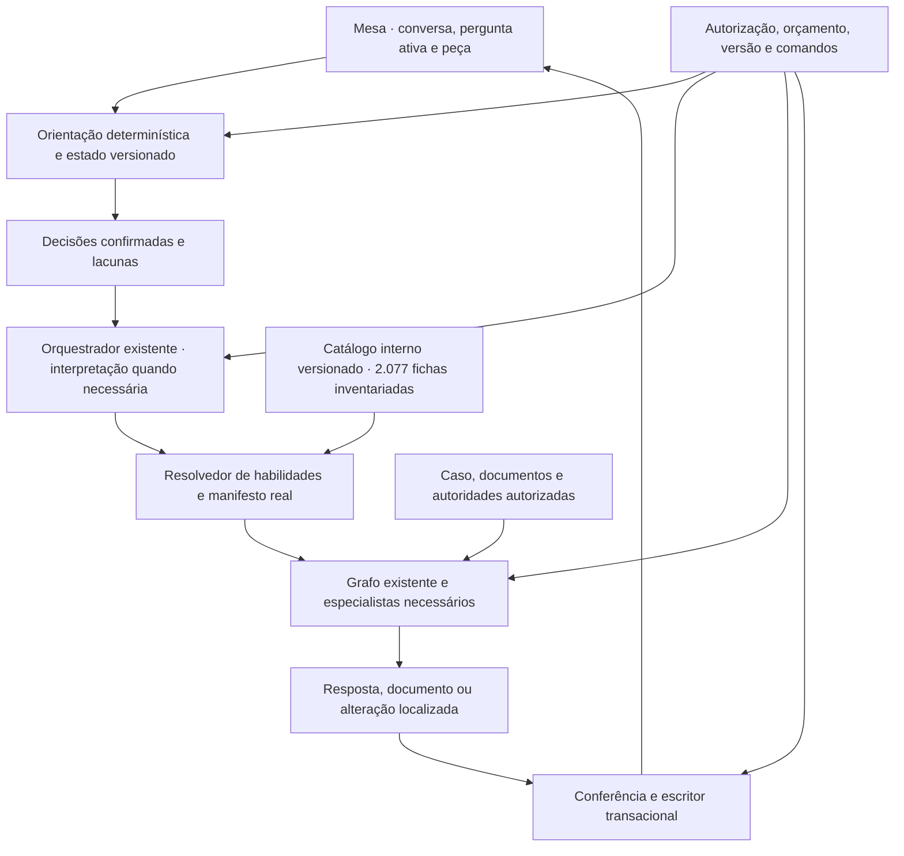
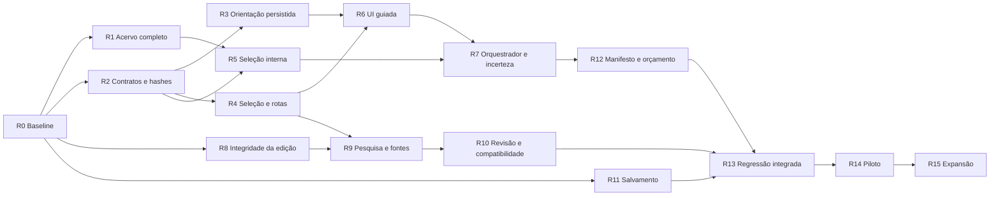

# ForgeLex — Plano detalhado da Mesa guiada e da seleção interna de habilidades

**Versão 2 · 10 de novembro de 2026 · Início autorizado por Boni**

> Este plano substitui a sequência de implementação do planejamento anterior e conserva seus requisitos funcionais e critérios de integridade. As tarefas abaixo são propostas. Sua execução depende da autorização correspondente. Boni é o único avaliador e aprovador humano. O documento usa as skills `superpowers:brainstorming`, `superpowers:writing-plans`, `design:design-handoff`, `design:ux-copy` e `design:accessibility-review` para organizar decisões, tarefas e especificações de interface. A elaboração ficou restrita ao planejamento.

## 1. Resultado esperado

A Mesa recebe um pedido livre ou oferece perguntas objetivas para ajudar o usuário a defini-lo. As respostas delimitam área, tarefa, peça e informações materiais. A seleção de Forma, Matéria, especialistas e ferramentas acontece no servidor. O usuário trabalha com conversa, peça e fontes, sem catálogo de habilidades na interface.

A experiência deve atender tanto ao pedido completo, como “revise esta contestação trabalhista”, quanto ao usuário que começa por “não sei qual peça preciso”. A Mesa aproveita o que já foi informado e pergunta o que realmente muda a execução. Uma resposta pode ser corrigida, com reavaliação das decisões dependentes e preservação do trabalho já registrado.

**Fluxo limpo e visual moderno são pilares inegociáveis.** A composição deve parecer uma mesa de trabalho atual, com hierarquia clara, tipografia legível e continuidade entre conversa e peça. A orientação aparece dentro da conversa. Informações complementares ficam acessíveis sob demanda e controles técnicos permanecem nos bastidores. A qualidade visual é critério de aceite do produto em desktop e celular.

As 2.077 habilidades capturadas entram na primeira frente de inventário e preparação do catálogo interno. O piloto valida o roteamento e a execução com um subconjunto identificado, enquanto o inventário completo continua disponível para expansão por área.

### Decisões expressas na conversa

- A condução ocorre por perguntas seletivas e objetivas.
- O usuário pode escolher “Não sei”, e a IA ajuda a identificar o contexto.
- A área influencia as perguntas seguintes sobre tarefa e peça.
- Habilidades e formas ficam nos bastidores.
- Fluxo limpo e visual moderno são critérios obrigatórios de produto.
- O redesenho contempla pesquisa, acervo, fontes, planejamento, edição, revisão, versões, retomada e controles de autorização/custo já estudados.
- Esta entrega refaz o planejamento. A implementação do produto é uma etapa posterior.

### Decisões técnicas propostas neste documento

- Usar regras determinísticas para respostas objetivas e aproveitar o orquestrador existente quando houver interpretação necessária.
- Manter uma pergunta ativa por vez e permitir texto livre no mesmo compositor.
- Registrar respostas, inferências e suas origens em um snapshot versionado da conversa.
- Usar hashes para identificar e conferir decisões, contexto e habilidades selecionadas. As regras e o orquestrador decidem a próxima ação.
- Carregar apenas as habilidades pertinentes ao papel e à questão em execução.
- Usar Penal como jornada principal do piloto, seguindo o exemplo do usuário, e Cível como regressão da Mesa existente.
- Reutilizar os componentes e tokens visuais do ForgeLex, com alterações focadas na condução e nos estados da Mesa.

## 2. Baseline e fontes

A auditoria principal examinou `8fcd1d0ea920898983b96db153848205a37b0a5b` e comparou essa linha à `main` remota `5d854da2cdae9c7c867e202e71ab8f4551cba3f6`. A conferência local feita para este plano encontrou o worktree de análise ainda em `8fcd1d0`, limpo. O diretório inicial `SDK` havia sido identificado em outra linha, com alterações preexistentes. A implementação deverá reconciliar a revisão efetivamente escolhida em R0.

As fontes de decisão são a auditoria, o plano anterior, os estudos REA e o ZIP verificado de habilidades. O MinutaIA mostrou contratos de planejamento, seleção de habilidades, eventos e edição. O Rimor mostrou contexto de pesquisa conservado e ligação com acervo. O comportamento dos backends desses produtos permanece parcialmente indeterminado. [Auditoria ForgeLex](../../architecture/2026-11-10-mesa-guiada-execucao.md#evidencias-locais) · [Plano anterior](../../architecture/2026-11-10-mesa-guiada-execucao.md#evidencias-locais) · [Análise Rimor](../../architecture/2026-11-10-mesa-guiada-execucao.md#evidencias-locais) · [Análise MinutaIA](../../architecture/2026-11-10-mesa-guiada-execucao.md#evidencias-locais).

### Conhecimento já existente no ForgeLex

| Elemento | Evidência na baseline | Aproveitamento |
|---|---|---|
| Perguntas | `LegalQuestionSchema`, `LegalAnswerSchema` e `QuestionOptions` já aceitam escolhas, texto e desconhecimento. | Reutilizar contrato e apresentação para perguntas de execução e adaptar a composição da orientação inicial. |
| Plano | `TaskPlanSchema` já registra ação, questões, lacunas e necessidade de pesquisa, normas e procedimento. | Acrescentar o contexto da orientação em protocolo compatível. |
| Papéis | Orquestrador e seis especialistas, com grafo e replanejamento limitado. | Selecionar os papéis pertinentes, sem criação de um agente para cada habilidade. |
| Eventos | A API expõe `STATUS`, `QUESTION`, `DELIVERY`, `SOURCE` e `ERROR`. | Projetar estados úteis na conversa. |
| Execução | Comandos, leases, checkpoints e comparação de contexto. | Reutilizar autoridade do servidor e regras de recuperação. |
| Documento | Versões, ancestralidade, aprovação e escrita com comparação da versão atual. | Aplicar edição delimitada e preservar vínculos. |
| Pesquisa | Pesquisa salva, leitor e vínculo de autoridade ao caso. | Tornar a jornada contextual à Mesa. |

## 3. Princípios da experiência e do fluxo

1. **O pedido informado tem prioridade.** Se área e tarefa já estiverem claras no texto, a Mesa aproveita os dados.
2. **A pergunta precisa mudar uma decisão.** Perguntar por um campo apenas para completar cadastro produz atrito sem melhorar a execução.
3. **“Não sei” é uma resposta válida.** O usuário pode descrever o objetivo ou indicar documentos. A Mesa conserva a incerteza até resolvê-la.
4. **Inferência tem origem.** Uma área escolhida pelo usuário, uma hipótese do modelo e um fato de documento mantêm identidades distintas.
5. **A seleção interna é reproduzível.** A execução registra versões de regras, catálogo e habilidades utilizadas.
6. **O alvo de escrita é explícito.** Conversa, caso, peça, versão e escopo de edição devem corresponder ao que será enviado.
7. **Abrir, pesquisar, vincular, revisar e aplicar têm efeitos próprios.** Os rótulos e comandos acompanham essas diferenças.
8. **Conflito preserva o trabalho.** Uma versão concorrente ou resposta obsoleta deve produzir uma recuperação compreensível.
9. **A interface mostra decisões do advogado.** Identificadores, hashes e seleção de habilidades ficam nos registros internos apropriados.
10. **Conformidade com o manifesto real.** A Mesa descreve apenas capacidades efetivamente disponíveis para o usuário e para a operação.

## 4. Fluxos de produto

### 4.1 Começo sem contexto

```text
Mesa
  “O que você precisa fazer?”
  Campo de conversa + ação “Me ajude a começar”

Ao escolher ajuda
  “Em qual área você precisa trabalhar?”
  Penal · Cível · Trabalhista · Administrativo · Tributário
  Outra área · Não sei

Ao escolher Penal
  “O que você precisa fazer?”
  Elaborar uma peça · Analisar documentos · Revisar um texto
  Pesquisar fundamentos · Não sei

Ao escolher Elaborar uma peça
  “Você já sabe qual peça precisa?”
  Sim · Quero ajuda para identificar

Com a peça conhecida
  Pedir apenas o papel, contexto ou documento que ainda mude o trabalho.
  Apresentar resumo do pedido e a ação disponível.
```

A lista inicial de áreas é uma proposta de apresentação. “Outra área” permite buscar as demais áreas do catálogo interno com nomes jurídicos compreensíveis. O usuário pode retomar o campo livre a qualquer momento.

### 4.2 Pedido já completo

Entrada de referência: “Revise a fundamentação da peça aberta e aponte inconsistências”. A Mesa resolve a tarefa a partir do texto e da peça, confere o alvo e apresenta a revisão. Pergunta por área ou fase somente se a falta mudar a análise. A opção de revisar mantém a escrita documental bloqueada nesse caminho.

### 4.3 “Não sei” e identificação pela IA

1. Registrar desconhecimento no campo correspondente, com a versão da pergunta.
2. Aproveitar texto já informado e documentos autorizados. Se o objetivo continuar indefinido, pedir uma descrição curta.
3. Fazer a classificação pelo orquestrador na primeira execução autorizada que exija IA. Cliques nas opções determinísticas não iniciam inferência.
4. Se a hipótese mudar materialmente a peça, a posição processual ou o efeito pretendido, apresentar uma confirmação objetiva na conversa.
5. Se restarem caminhos distintos, fazer uma pergunta discriminante. Preservar uma saída limitada quando a informação necessária continuar indisponível.

A identificação por IA integra os controles financeiros reais. O plano não promete que uma inferência seja gratuita. O cliente deve apresentar o custo aplicável antes do despacho que o exige. Uma retomada que a política atual trate como nova operação conserva o consentimento correspondente.

### 4.4 Mudança de resposta

O resumo do pedido permite “Alterar”. Trocar Penal por Cível recalcula as decisões que dependem da área. Trocar apenas um detalhe editorial conserva o que continua válido. A Mesa mostra quais decisões do pedido precisam ser revistas e mantém a minuta anterior acessível.

O servidor cria uma nova revisão de contexto. Saídas anteriores continuam identificadas pelo snapshot de origem. Uma execução em andamento segue os mecanismos existentes de cancelamento cooperativo ou obsolescência. A resposta corrigida não promove silenciosamente um resultado calculado com a base anterior.

### 4.5 Pesquisa, criação, revisão e edição

| Intenção | Entrega | Ação seguinte |
|---|---|---|
| Pergunta/análise | Resposta vinculada ao contexto e fontes disponíveis. | Conferir fonte ou continuar a conversa. |
| Pesquisa | Resultado conservável e critérios identificados. | Conferir, vincular ao caso ou pesquisar novamente. |
| Criar peça | Documento candidato com referências e limitações. | Editar, conferir ou registrar decisão. |
| Revisar | Achados e sugestões vinculados à versão examinada. | Pedir ou selecionar alteração. |
| Editar peça | Alterações delimitadas sobre versão/hash de origem. | Aplicar conforme autorização e contrato da operação. |

## 5. Arquitetura de responsabilidades



### Fronteiras de responsabilidade

| Unidade | Responsabilidade |
|---|---|
| `WritingDeskScreen` | Coordenar conversa, peça, seleção e a apresentação da orientação. |
| Orientação no servidor | Escolher a próxima pergunta determinística, validar resposta e registrar revisão. |
| Orquestrador | Interpretar pedido/incerteza, definir ação e dependências com o contexto autorizado. |
| Resolvedor de habilidades | Transformar decisões e questões em um conjunto elegível de versões de habilidade. |
| Grafo | Executar os especialistas e ferramentas autorizados, dentro dos limites já aplicáveis. |
| Persistência | Validar owner, revisão, versão base, escrita e replay. |
| Apresentação pública | Exibir pergunta, resumo do trabalho, andamento, resultado e fontes. |
| Auditoria interna | Conservar decisões, versões, hashes e justificativas sucintas de seleção. |

O catálogo e as regras de elegibilidade vivem no servidor. Respostas HTTP para a Mesa devem projetar apenas campos necessários ao usuário. A resposta do resumo público não deve conter corpo, título ou identificador das habilidades selecionadas. As fontes jurídicas citadas continuam disponíveis para conferência.

## 6. Respostas, hashes e regras de roteamento

### 6.1 Estado da orientação

Proposta de contrato interno, a validar com os schemas da revisão escolhida:

```ts
type DecisionValue = {
  value: string | null;
  status: 'known' | 'unknown' | 'proposed' | 'confirmed';
  origin: 'user' | 'document' | 'model';
  questionId?: string;
  evidenceIds?: string[];
};

type GuidanceSnapshot = {
  protocolVersion: 1;
  rulesVersion: string;
  revision: number;
  area: DecisionValue;
  action: DecisionValue;
  documentType: DecisionValue;
  partyRole: DecisionValue;
  stage: DecisionValue;
  activeQuestionId: string | null;
  guidanceHash: string;
};

type SkillBinding = {
  catalogVersion: string;
  entries: Array<{
    id: string;
    version: number;
    contentHash: string;
    role: string;
    issueIds: string[];
  }>;
  resolutionHash: string;
};
```

Esses tipos descrevem propostas de domínio. As versões e os campos não são APIs já implementadas. Reutilizar `LegalQuestion`/`LegalAnswer` para a interação que o contrato já suporta. O snapshot mantém o estado de decisões e as origens, enquanto o histórico de respostas mantém a sequência.

### 6.2 Função dos hashes

| Identificador | Entrada e finalidade |
|---|---|
| `guidanceHash` | Versão das regras e mapa canônico de decisões codificadas, com estados e origens. Identifica a configuração da orientação. |
| `resolutionHash` | `guidanceHash`, revisão do contexto, versão do catálogo e conjunto ordenado de habilidades com suas versões/hashes. Identifica a seleção interna da execução. |
| Hash da versão documental | Usar o contrato existente sobre a representação definida do documento. Confere o alvo de escrita. |
| `commandId` ou chave de idempotência | Identidade de uma intenção de operação. Reutilizar os mecanismos existentes ou a extensão aditiva de salvamento prevista. |

Usar SHA-256 sobre serialização determinística definida e testada. Ordenar chaves de objetos e conjuntos que sejam semanticamente desordenados. Preservar a ordem quando ela tiver significado, como a ordem dos tópicos. Usar o mesmo algoritmo na validação do servidor. O cliente recebe IDs opacos de comando e revisão quando necessários.

Hashes não concedem acesso, não demonstram correção jurídica e não deduplicam ações legítimas por conta própria. Evitar dados pessoais livres no hash de roteamento. Os snapshots sensíveis seguem a autorização e retenção existentes. Uma nova intenção pode ter o mesmo contexto/hash e ainda constituir outra operação.

### 6.3 Política de próxima pergunta

`resolveNextQuestion(snapshot, capabilities)` deve:

- Aproveitar valores explícitos do pedido e decisões já confirmadas.
- Perguntar por ação e área somente quando faltarem e afetarem o trabalho.
- Derivar as opções seguintes das regras compatíveis com área e ação.
- Permitir desconhecimento e texto quando cabíveis.
- Exigir confirmação de uma hipótese apenas quando ela alterar materialmente o trabalho.
- Encerrar a orientação quando já houver contexto suficiente para a ação disponível.
- Devolver um motivo interno verificável para seleção da pergunta, sem expor detalhes técnicos no produto.

Um score do modelo pode auxiliar o roteamento, mas não será tratado como probabilidade calibrada ou prova da área correta. O aceite usa exemplos rotulados e comportamentos de recuperação.

## 7. Persistência e compatibilidade

### Orientação antes da execução paga

A proposta é usar a conversa e seus snapshots existentes também para a preparação determinística. Um serviço específico cria/retoma a conversa e registra respostas sem criar job de inferência. O snapshot interno de orientação entra como extensão opcional e versionada do contexto. A execução autorizada consome a revisão esperada dessa conversa.

O endpoint de orientação valida owner, capacidade e revisão. O `StartExecutionSchema` deve continuar recusando campos de contexto que pertençam exclusivamente ao servidor. A seleção de habilidades é construída no servidor e fixada no checkpoint do protocolo novo. As projeções públicas de execução e contexto omitem esses detalhes internos.

### Leitura e escrita compatíveis

- Introduzir primeiro leitores que aceitem a extensão opcional. Ativar o escritor depois, na revisão de aplicação compatível.
- Manter o formato e os hashes das conversas e entregas históricas.
- Usar o protocolo de workflow novo proposto no plano anterior, com numeração confirmada em R0. Checkpoints antigos continuam no protocolo original.
- Reutilizar payloads JSON e repositórios existentes quando suportarem os dados sem enfraquecer a integridade. Uma migration eventualmente necessária deve ser aditiva e documentada antes de sua execução.
- Reservar comandos idempotentes próprios para respostas/correções da orientação e para salvamento. Um hash de decisão não substitui o registro do resultado do comando.
- Validar concorrência entre resposta, correção, troca de documento e início da execução.

## 8. Preparação do catálogo completo e seleção oculta

### Entrada já disponível

O arquivo capturado contém 2.077 fichas oficiais ativas, com 303 de Forma e 1.774 de Matéria, mais manifesto de integridade. O ZIP foi reaberto e todos os arquivos foram conferidos. SHA-256 do ZIP `2a0efbbc301e53c357d5fe6baac1a896c84669fc1646a62c2aec410550543d01`. [Acervo capturado](../../architecture/2026-11-10-mesa-guiada-execucao.md#evidencias-locais).

### Tratamento proposto

1. Validar manifesto, contagens, caminhos, conteúdo e metadados das 2.077 fichas em área de trabalho isolada.
2. Produzir índice interno com tipo, área/subárea, descrição, gatilhos, versão, hashes, origem e estado de avaliação.
3. Identificar sobreposições, fichas com múltiplos temas, referências incompletas e casos ambíguos. Manter os itens no inventário com seu estado explícito.
4. Definir o subconjunto elegível do piloto com avaliação de Boni. A seleção técnica e a avaliação jurídica têm campos próprios.
5. Definir a forma de incorporação do conteúdo ao ForgeLex considerando as condições de reutilização e a origem registrada. O inventário técnico do acervo completo pode ser concluído independentemente dessa decisão.
6. Resolver a habilidade de Forma a partir da peça confirmada e as habilidades de Matéria a partir das questões do caso.
7. Carregar os conteúdos necessários ao papel corrente, respeitando o orçamento de contexto da execução.
8. Fixar a versão/hash da seleção. Atualizar o catálogo gera nova revisão para execuções futuras.

### Precedência e confiança

A autorização do usuário, a versão documental e os controles do servidor governam os efeitos. As habilidades oferecem orientação. Fontes recuperadas sustentam referências jurídicas com os limites identificados. Conteúdo de documento processual é tratado como dado. Conflitos entre habilidades ou com o pedido produzem esclarecimento ou limitação, conforme impacto.

O resolvedor deve registrar o motivo da escolha por regra, questão e evidência. O usuário pode corrigir área, tarefa ou objetivo sem precisar descobrir o nome de uma habilidade.

## 9. Especificação de UI/UX

### 9.1 Organização da Mesa

```text
Desktop
┌─────────────────────────────────────────────────────────────┐
│ Mesa                 [Caso/peça]                [Fontes]     │
├──────────────┬──────────────────────┬────────────────────────┤
│ Conversas    │ Conversa             │ Peça ou fonte aberta   │
│ recolhíveis  │ Resumo do pedido     │                        │
│              │ Pergunta ativa       │ Editor/contexto        │
│              │ Campo de texto       │                        │
└──────────────┴──────────────────────┴────────────────────────┘

Celular
  Conversa  |  Peça
  Resumo do pedido recolhível
  Pergunta ativa e campo livre na conversa
  Fontes/conferências em diálogo acessível
```

O wireframe organiza responsabilidades e estados. As áreas se abrem conforme a tarefa. Sem peça selecionada, a conversa recebe o espaço principal. Com a peça aberta, o editor ganha área suficiente para leitura e edição. Medidas finais devem ser conferidas no layout existente antes da implementação. Preservar a identidade visual, com `Inter` na interface, `Georgia`/serif nos usos editoriais, `ivory`, `cognac` e `champagne` já definidos em `tailwind.config.js` e `index.css`. Modernizar a composição por hierarquia, densidade, espaçamento e estados de interação.

### Padrão visual obrigatório

| Estado | Elemento principal | Acesso complementar |
|---|---|---|
| Mesa inicial | Campo de conversa e envio do pedido | “Me ajude a começar” como ação secundária compacta |
| Pergunta ativa | Pergunta curta e opções necessárias | Resumo em uma linha, com “Alterar” |
| Peça aberta | Documento e conversa coordenados | Fontes, revisão e histórico no contexto da peça |
| Proposta | Trecho afetado e ação de aplicação | Comparação e origem sob demanda |
| Conflito ou falha | O que aconteceu e como continuar | Detalhes técnicos apenas no registro interno |

Cada estado tem uma ação principal identificável. A pergunta ativa pertence à conversa e respeita a mesma hierarquia visual das mensagens. Perguntas anteriores ficam no histórico, com edição pelo resumo do pedido. Preservar espaços vazios úteis e usar divisórias discretas. O primeiro olhar deve mostrar a tarefa atual e o próximo passo. A validação visual deve verificar densidade, alinhamento, contraste, texto longo e transição de estado em capturas de desktop e celular.

### 9.2 Componentes e limites

| Componente | Função e comportamento |
|---|---|
| Pergunta guiada | Um `fieldset` com `legend` e opção “Não sei”. Escolha única determinística pode avançar por botão explícito. Seleção múltipla usa caixas de seleção e “Continuar”. A confirmação de uma ação com efeitos ou custo mantém seu controle próprio. |
| Resumo do pedido | Exibe área/tarefa/peça confirmadas e ação “Alterar”. Oculta detalhes técnicos e catálogo interno. |
| Compositor | Permanece disponível para pedido livre. Aceita informação que pode resolver perguntas pendentes. |
| Estado da execução | Apresenta andamento útil, pergunta material ou falha recuperável. Usa os eventos existentes. |
| Editor | Mantém buffer, versão e alvo. Preserva texto ao abrir fonte e ao navegar na Mesa. |
| Fonte/conferência | Abre sob demanda sem deslocar o alvo da peça. Mostra referência e limitações pertinentes. |
| Decisão/aplicação | Apresenta versão e trecho afetado conforme a ação, com confirmação financeira quando aplicável. |

### 9.3 Comportamento responsivo proposto

- Abaixo de `lg` do Tailwind existente, alternar Conversa/Peça como na Mesa atual.
- No desktop, manter a composição atual e as conversas recolhíveis. Abrir a orientação dentro da coluna da conversa.
- Usar largura legível para pergunta e opções. Textos longos devem quebrar linha, sem truncar escolhas jurídicas relevantes.
- Adotar espaçamento da escala existente, com 12–16 px entre grupos e área interativa mínima de 44 × 44 px como critério de produto.
- Manter foco e posição da conversa ao abrir/fechar fontes. Uma pergunta nova deve ser anunciada, com foco previsível e sem salto durante digitação.
- Respeitar redução de movimento. A mudança de pergunta pode usar transição curta, sem animação que impeça seleção ou leitura.

### 9.4 Microcopy de referência

| Estado | Texto e ação propostos |
|---|---|
| Início | “O que você precisa fazer?” · “Me ajude a começar” |
| Área | “Em qual área você precisa trabalhar?” · “Outra área” · “Não sei” |
| Objetivo | “O que você precisa fazer neste caso?” |
| Peça desconhecida | “Conte brevemente o que você precisa resolver.” |
| Hipótese material | “Pelo que você informou, o trabalho parece ser na área Penal. Está correto?” |
| Resposta em gravação | “Registrando sua resposta…” |
| Resposta obsoleta | “O pedido foi atualizado em outra aba. Confira a versão atual para continuar.” |
| Contexto insuficiente | Pergunta concreta sobre o que falta e por que a decisão depende disso. |
| Versão concorrente | “Há uma versão mais recente da peça. Sua edição continua aqui.” · “Conferir versão” |
| Retomada | “Seu trabalho foi recuperado.” |

As mensagens de orçamento devem usar valores e condições devolvidos pelo serviço vigente. A interface não deve fixar preços no texto de planejamento.

### 9.5 Acessibilidade e estados

Planejar navegação por teclado, foco visível, rótulos e grupos semânticos. Medir contraste de texto normal de pelo menos 4,5:1 e de texto grande de 3:1, além do contraste dos componentes conforme o critério aplicável. Testar zoom, quebra de linha, erro anunciado e navegação com leitor de tela. O alvo de toque de 44 px é uma decisão de produto deste plano. [Contraste de texto](https://www.w3.org/WAI/WCAG21/Understanding/contrast-minimum.html) · [Operação por teclado](https://www.w3.org/WAI/WCAG21/Understanding/keyboard.html) · [Foco visível](https://www.w3.org/WAI/WCAG21/Understanding/focus-visible.html).

Cobrir vazio, carregando, respondido, hipótese pendente, erro de leitura, gravação recusada, acesso revogado, versão obsoleta, execução ativa, cancelamento e retomada. “Não sei” deve aparecer como estado persistido, e não como campo vazio.

## 10. Estrutura de arquivos e organização de engenharia

Os arquivos novos abaixo são propostas. Reconciliar com a árvore de execução em R0 e reutilizar equivalentes existentes.

| Área | Arquivos previstos |
|---|---|
| Contratos de orientação | Criar `packages/domain/src/contracts/desk-guidance.ts` e teste homônimo. Modificar `agentic-workspace.ts` e exportações para extensão interna opcional/versionada. |
| Catálogo/seleção | Criar `packages/legal-agents/src/skills/skill-catalog.ts`, `skill-resolver.ts`, `skill-binding.ts` e testes respectivos. Recursos ficam no servidor, com diretório de catálogo fixado na implantação futura. |
| Inventário do acervo | Criar `scripts/skills/inventory-catalog.mjs` e teste Node. Reutilizar JSZip já declarado no projeto se a revisão de execução o confirmar. Saídas de análise ficam em área de trabalho definida, sem exposição pelo servidor estático. |
| Regras guiadas | Criar `packages/legal-workflows/src/desk-guidance/guidance-rules.ts`, `guidance-resolver.ts` e testes. Reutilizar perguntas e validação do domínio. |
| Serviço de orientação | Criar `apps/api/src/agentic-workspace/guidance-service.ts`, `guidance-routes.ts` e testes. Reutilizar conversa, contexto e locks existentes. |
| Persistência | Modificar `agentic-workspace-repository.ts`, `native-case-task-repository.ts` e `draft-repository.ts` no escopo das tarefas. Estender payloads JSON de modo compatível quando suficiente. |
| Preparação/execução | Modificar `execution-service.ts`, `case-task-driver.ts`, `commercial-runtime.ts`, `case-task.ts` e perfis versionados. Preservar limites e writers históricos. |
| Estado da Mesa | Modificar `desk-model.ts`, `WritingDeskScreen.tsx`, `AgenticWorkspaceScreen.tsx`, `Composer.tsx` e `DraftStudioScreen.tsx`. Criar `desk-selection.ts` e `navigation/desk-location.ts` com testes. |
| UI guiada | Criar `apps/web/src/agentic-workspace/GuidedQuestion.tsx`, `GuidanceSummary.tsx` e testes. Reutilizar `QuestionOptions` quando a extensão de props mantiver o comportamento atual. |
| APIs do cliente | Estender `agentic-workspace/client.ts` com comandos da orientação. Tipos públicos recebem apenas a projeção segura. |
| Edição | Criar/estender contratos de `desk-edit`, validador de patches e preservação de metadados conforme o plano anterior. |
| Revisão/fontes | Reutilizar `DecisionReader`, `SaveAuthorityToCase`, `DraftCanvas`, `ReviewPanel`, `EditorialReviewPanel` e o modelo da fila. |
| Navegação | Modificar `App.tsx`, `AppContext.tsx` e `routes.ts` para usar adaptação comum. |
| Regressão | Estender `writing-desk.spec.ts`, `editorial-review.spec.ts`, testes de workflow/execução e PostgreSQL. Criar `guided-desk.spec.ts` e incluir na configuração Playwright da Mesa. |

Manter `domain` sem importação de runtime dos pacotes superiores. Schemas puros de leitura de evidências devem ficar em `domain` quando forem usados por persistência. As regras de orientação podem consumir domínio e catálogo por interface. O pacote de persistência não deve passar a importar o workflow.

## 11. Sequência detalhada de implementação



### R0 — Reconciliar a revisão e os contratos

**Concluída em 10/11/2026.** [Baseline e evidência](../../architecture/2026-11-10-mesa-guiada-execucao.md#r0--revisão-de-partida).

**Entrega.** Baseline de execução e mapa de mudanças aprovado no escopo de implementação.

**Arquivos.** Leitura de `AGENTS.md`, manifests, contratos, plano e arquivos auditados.

- [x] Confirmar remoto, branch, HEAD, worktree e alterações preexistentes.
- [x] Verificar a diferença entre as revisões da auditoria e de execução e registrar o impacto no mapa de tarefas.
- [x] Conferir scripts de build/teste e dependências já declaradas.
- [x] Mapear leitores estritos de contexto/checkpoint e sua compatibilidade com orientação opcional.
- [x] Identificar v11 como próximo protocolo na baseline e registrar a estratégia leitor antes do escritor.

**Teste/aceite.** Cada contrato novo tem consumidor e política de compatibilidade definidos. Nenhuma alteração alheia é perdida. A execução identifica o checkout correto e o ambiente descartável de teste.

### R1 — Inventariar as 2.077 habilidades

**Concluída em 10/11/2026.** [Inventário, testes e elegibilidade](../../architecture/2026-11-10-mesa-guiada-execucao.md#r1--inventário-técnico).

**Entrega.** Índice técnico completo, reproduzível, com estado de avaliação por item.

**Arquivos.** `scripts/skills/inventory-catalog.mjs`, teste Node e recursos de análise internos.

- [x] Revalidar hash do ZIP, manifesto, 303/1.774 itens, IDs e hashes de conteúdo.
- [x] Testar rejeição de caminho inseguro, entrada duplicada, categoria inválida e conteúdo divergente.
- [x] Extrair metadados em formato normalizado, preservando origem, versão e hash original.
- [x] Produzir mapa de área/subárea e cobertura de formas com itens ambíguos identificados.
- [x] Registrar a política de incorporação e a lista elegível do piloto separadamente do inventário.

**Aceite.** Exatamente 2.077 registros rastreáveis. Nenhum item some por falha de classificação. Catálogo e textos permanecem fora dos assets públicos.

### R2 — Contratos de orientação e hashes

**Concluída em 10/11/2026.** [Contratos e evidência de validação](../../architecture/2026-11-10-mesa-guiada-execucao.md#r2--contratos-de-orientação-e-hashes).

**Entrega.** Schemas, serialização canônica e estados de resposta definidos.

**Arquivos.** `desk-guidance.ts`, teste, extensão opcional do contexto e exportações.

- [x] Testar escolhido, desconhecido, proposto e confirmado com suas origens.
- [x] Testar resposta vazia, opção inexistente, pergunta obsoleta e origem de evidência ausente.
- [x] Implementar `GuidanceSnapshot` e `SkillBinding` com versões de protocolo.
- [x] Implementar hashes determinísticos, com ordem semântica documentada.
- [x] Separar hashes dos campos de autorização e comando e recusar a orientação interna quando enviada pelo cliente.

**Aceite.** Mesmo snapshot canônico gera o mesmo hash. Alterar decisão relevante, versão de regra ou habilidade altera o vínculo esperado. Objetos antigos continuam legíveis.

### R3 — Orientação persistida anterior à inferência

**Concluída em 10/11/2026.** [Rotas e evidência de validação](../../architecture/2026-11-10-mesa-guiada-execucao.md#r3--orientação-persistida-anterior-à-inferência).

**Entrega.** Criar/retomar orientação e registrar resposta/correção com revisão e comando.

**Arquivos.** `guidance-service.ts`, `guidance-routes.ts`, repositório de conversa e testes.

- [x] Testar fluxo determinístico com driver que falha se for chamado.
- [x] Reutilizar conversa e snapshots para preparar a tarefa sem criar job de inferência.
- [x] Validar comando, owner, opção e revisão antes de registrar resposta.
- [x] Implementar correção com nova revisão e invalidação de decisões dependentes.
- [x] Testar duas abas respondendo ou corrigindo a mesma pergunta.
- [x] Testar recarga e retomada da pergunta ativa.

**Aceite.** Respostas de formulário não chamam provider ou reservam orçamento. Um comando repetido retorna o mesmo resultado. Uma resposta obsoleta falha sem substituir a atual.

### R4 — Seleção única e navegação da Mesa

**Entrega.** Conversa, caso, peça, versão, orientação e URL coordenados.

**Arquivos.** `desk-selection.ts`, `desk-location.ts`, `App`, contexto, Mesa e editor.

- [x] Reproduzir troca de conversa mantendo peça incompatível e perda de parâmetros ao voltar à Mesa.
- [x] Implementar transições puras e adaptação comum de URL.
- [x] Integrar orientação ao contexto selecionado sem duplicar o buffer da peça.
- [x] Preservar histórico do navegador, aliases antigos e texto local.
- [x] Ignorar respostas tardias de uma seleção anterior.

**Aceite.** Alvo apresentado corresponde ao enviado. Voltar/Avançar e recarga restauram a seleção persistida. Trocar caso não aplica decisão de uma conversa anterior.

**Evidência.** 67 testes unitários e 36 testes Playwright locais aprovados. O [registro de execução](../../architecture/2026-11-10-mesa-guiada-execucao.md#r4--seleção-única-e-navegação-da-mesa) descreve a seleção e o limite da integração com a orientação.

### R5 — Seleção interna de habilidades

**Entrega.** Catálogo leve, elegibilidade e vínculo fixado por execução.

**Arquivos.** `skill-catalog.ts`, `skill-resolver.ts`, `skill-binding.ts` e testes.

- [x] Testar peça conhecida, matéria conhecida, área desconhecida e questão multidisciplinar.
- [x] Resolver Forma pela peça confirmada e Matéria pelas questões/evidências pertinentes.
- [x] Validar versão elegível e limites de contexto antes do carregamento.
- [x] Registrar motivo de seleção e conflito de habilidades.
- [x] Congelar conteúdo/hash para a execução. Atualização posterior do catálogo não muda o snapshot.
- [x] Testar que habilidade e texto processual não podem ampliar ferramentas/permissões.

**Aceite.** Seleção reproduzível, sem conteúdo de habilidade na resposta pública da Mesa. Registro interno identifica exatamente as versões usadas. Ausência ou conflito gera limitação ou pergunta material.

**Evidência.** 13 testes novos com fichas sintéticas e 385 testes locais aprovados no total. A seleção e o snapshot estão prontos como módulos internos. O [registro de execução](../../architecture/2026-11-10-mesa-guiada-execucao.md#r5--seleção-interna-de-habilidades) delimita a integração prevista em R7 e R10.

### R6 — Composição de UI/UX da orientação

**Entrega.** Pergunta ativa, texto livre e resumo editável na Mesa.

**Arquivos.** `GuidedQuestion`, `GuidanceSummary`, `QuestionOptions`, compositor e Mesa.

- [ ] Implementar estados da seção 9 com componentes/tokens existentes.
- [ ] Permitir resposta por opção, texto e “Não sei” conforme o contrato.
- [ ] Permitir corrigir o pedido pelo resumo sem expor catálogo, hashes ou nomes internos.
- [ ] Preservar edição da peça ao abrir fontes e responder.
- [ ] Validar teclado, foco, anúncio de estado, contraste e comportamento móvel.
- [ ] Conferir uma ação principal por estado, hierarquia da peça, densidade, tipografia e transições nos estados da seção 9.
- [ ] Apresentar a Boni a jornada visual concreta em desktop e celular, com as decisões e o próximo passo reconhecíveis em cada estado.

**Aceite.** Uma pergunta ativa por vez. O usuário consegue completar/corrigir o pedido com teclado. A visão normal contém apenas contexto útil, ação, conversa e documento/fontes.

### R7 — Integração com o orquestrador e “Não sei”

**Entrega.** Interpretação e perguntas materiais no fluxo agêntico existente.

**Arquivos.** `case-task.ts`, perfis versionados, `case-task-driver`, `execution-service` e contratos novos.

- [ ] Testar pedido completo sem perguntas repetidas.
- [ ] Testar área desconhecida com descrição suficiente e insuficiente.
- [ ] Consumir o snapshot confirmado e aproveitar o plano para inferências necessárias.
- [ ] Perguntar quando a hipótese alterar materialmente a tarefa. Registrar origem e evidências da proposta.
- [ ] Reutilizar `QUESTION` e projeção do plano quando compatíveis. Manter snapshots internos de habilidades no servidor.
- [ ] Testar correção durante execução, obsolescência, cancelamento e retomada.

**Aceite.** Pedidos completos avançam. “Não sei” produz ajuda útil. Hipótese material não vira fato silenciosamente. O grafo executa apenas papéis necessários e conserva seus limites de replanejamento.

### R8 — Integridade documental e edição delimitada

**Entrega.** Preservação de vínculos e patches sobre a versão correta.

**Arquivos.** `native-case-task-repository`, contratos/validador de `desk-edit`, metadados e writer.

- [ ] Reproduzir perda de vínculos na nova versão derivada e insuficiência da regeneração integral.
- [ ] Carregar bundle original e preservar citações, fatos, provas, autoridades e teses fora da alteração.
- [ ] Validar âncoras, versão/hash, intervalos e Unicode.
- [ ] Materializar o resultado no servidor a partir de patches para o protocolo novo.
- [ ] Testar revisão que tenta devolver documento e edição fora do escopo.
- [ ] Testar edição concorrente e replay após escrita.

**Aceite.** Revisão cria zero versões. Conteúdo fora dos intervalos fica idêntico. Comando repetido cria uma única versão. Original, ancestralidade e fontes conservam sua integridade.

### R9 — Pesquisa e fontes na Mesa

**Entrega.** Jornada de busca conservada, conferência e vínculo ao caso.

**Arquivos.** `SavedResearchPanel`, leitor, `SaveAuthorityToCase`, Casos, fontes do editor.

- [ ] Reutilizar os contratos existentes de abrir pesquisa salva e pesquisar novamente.
- [ ] Abrir a fonte sem mudar a seleção de escrita.
- [ ] Confirmar caso de destino quando houver ambiguidade de vínculo.
- [ ] Distinguir identidade, fidelidade da citação e aplicabilidade nos pontos de conferência.
- [ ] Testar capacidade desabilitada, acesso revogado, fonte indisponível e resultado antigo.

**Aceite.** Abrir cópia conservada não dispara busca nova. Vínculo ocorre no caso escolhido e preserva proveniência. A peça e seu buffer permanecem acessíveis.

### R10 — Revisão, aprovação e compatibilidade histórica

**Entrega.** Operações necessárias acessíveis na Mesa e leitores compatíveis.

**Arquivos.** `ReviewPanel`, `EditorialReviewPanel`, fila, schemas puros de evidências e repositório.

- [ ] Recolocar conferência, decisão editorial, aplicação e aprovação nos contextos corretos.
- [ ] Adaptar entradas antigas de Revisão e Rascunhos.
- [ ] Corrigir o leitor editorial que limita evidências a checkpoints até v8.
- [ ] Validar versões suportadas com fixtures, incluindo o protocolo novo quando definido.
- [ ] Testar aprovação sobre versão antiga e consulta de histórico sem geração.

**Aceite.** Operações têm entrada funcional na Mesa. Decisões vinculam versão e autoria. Leitores aceitam formatos suportados e recusam adulteração. Abertura de histórico não chama provider.

### R11 — Salvamento atômico e recuperável

**Entrega.** Criação e primeira versão na mesma transação, com recuperação de comando.

**Arquivos.** `draft-service`, `draft-repository`, registro de comando compatível, handlers e editor.

- [ ] Testar falha entre criação e primeira versão.
- [ ] Unir as escritas no guard/transação existentes.
- [ ] Registrar intenção de salvar e fingerprint por owner e alvo.
- [ ] Recuperar resposta perdida antes de repetir escrita.
- [ ] Manter suporte aos clientes antigos com contrato aditivo.
- [ ] Testar duas conexões, payload divergente na mesma chave e versão posterior.

**Aceite.** Falha anterior ao commit deixa zero rascunhos órfãos. Replay retorna o resultado original. Nenhum usuário consulta o comando de outro. Eventual migration é aditiva e tem procedimento próprio.

### R12 — Manifesto, contexto e controles financeiros

**Entrega.** Capacidades reais, seleção interna e despacho financeiro coerentes.

**Arquivos.** Bootstrap, driver, runtime comercial e testes de integração.

- [ ] Testar que cliques determinísticos não criam inferência/reserva.
- [ ] Exigir confirmação aplicável antes da interpretação que use provider.
- [ ] Verificar manifesto derivado das ferramentas realmente registradas.
- [ ] Cobrir ausência de provider normativo na composição auditada.
- [ ] Medir o conteúdo carregado e recusar excesso de modo explícito, sem truncar fonte ou habilidade silenciosamente.
- [ ] Preservar regras de operação utilizável, liquidação, cancelamento e consumo incerto.

**Aceite.** O pedido nunca promete ferramenta ausente. Catálogo e seleção não controlam preço/provider. Operações financeiras mantêm o contrato vigente e são verificadas com transporte simulado.

### R13 — Regressão integrada e revisão de exposição

**Entrega.** Evidência de que o fluxo completo preserva os contratos anteriores.

**Arquivos.** `guided-desk.spec.ts`, suites da Mesa, revisão, workflow, persistência e execução.

- [ ] Exercitar criação, revisão, edição, pesquisa e fontes com orientação completa e pedido livre.
- [ ] Trocar respostas, área, conversa e caso com buffer local e respostas tardias.
- [ ] Inspecionar DOM e respostas públicas para ausência de corpo/IDs/títulos de habilidades.
- [ ] Testar snapshots antigos e protocolos novos na mesma aplicação.
- [ ] Cobrir perda de resposta, concorrência, cancelamento e recuperação.
- [ ] Executar tipos, lint, build, suites pertinentes e PostgreSQL descartável.

**Aceite.** Critérios da seção 14 passam na mesma revisão. Falhas preexistentes e testes ignorados são registrados sem contarem como aprovação.

### R14 — Piloto Penal e regressão Cível

**Entrega.** Uma jornada guiada completa e mensurável com catálogo interno.

**Dados.** Casos sintéticos, fontes autorizadas e habilidades identificadas por versão.

- [ ] Preparar jornada Penal com peça explicitamente escolhida e outra com “Não sei”.
- [ ] Usar como candidato técnico de Forma `resposta-acusacao`, v3, existente no acervo capturado, após decisão de incorporação e avaliação pertinente.
- [ ] Selecionar Matéria apenas pelas questões do caso. `cadeia-custodia-cpp-158`, v3, é um candidato de teste quando a fixture efetivamente contiver essa questão.
- [ ] Incluir um caso em que esse tema não aparece para testar seleção excessiva.
- [ ] Repetir jornada Cível existente para conferir regressões.
- [ ] Comparar baseline, Mesa guiada e Mesa guiada com habilidades no mesmo conjunto de casos.
- [ ] Usar saídas simuladas/gravadas para contratos. Ensaios reais posteriores recebem corpus e orçamento específicos.

**Aceite.** Seleção corresponde às questões, origem das inferências é rastreável, texto permanece íntegro e o usuário conclui o trabalho sem conhecer os nomes internos. A avaliação jurídica e de experiência é de Boni.

### R15 — Expansão por área e operação

**Entrega.** Aumentar a elegibilidade do catálogo e a cobertura de fluxos com evidência.

- [ ] Expandir formas e matérias pelos casos priorizados, aproveitando o inventário das 2.077 fichas.
- [ ] Registrar versão de catálogo, cobertura de perguntas e resultados da avaliação de cada lote.
- [ ] Medir perguntas desnecessárias, abandono, correções, custo de contexto e qualidade das entregas.
- [ ] Ajustar regras e habilidades versionadamente, conservando execuções anteriores.

**Aceite.** Cada expansão tem cobertura e avaliação identificadas. O tamanho do catálogo não amplia automaticamente as ferramentas ou o custo permitido por execução.

## 12. Correspondência com o plano anterior

| Plano anterior | Onde entra nesta versão |
|---|---|
| T0 · baseline | R0 |
| T1 · metadados | R8 |
| T2 · seleção/conversa | R4 e integração de R3/R7 |
| T3 · rotas | R4 |
| T4 · contrato de edição | R8 |
| T5 · execução/escrita | R7 e R8 |
| T6 · revisão na Mesa | R9 e R10 |
| T7 · checkpoints | R0 e R10 |
| T8 · salvamento | R11 |
| T9 · capacidades | R12 |
| T10 · validação integrada | R13 e R14 |

O acréscimo funcional desta versão está em R1–R3, R5–R7 e na expansão R15. O roteiro de base continua abrangendo todas as correções documentais e operacionais identificadas.

## 13. Matriz de riscos e regressões

| Risco | Verificação específica | Proprietário |
|---|---|---|
| Perguntas repetidas | Pedido já contém área/tarefa/peça e deve avançar. | R7 |
| “Não sei” virar uma área automática | Persistir unknown, origem da hipótese e confirmação quando material. | R2/R7 |
| Habilidade errada por palavra solta | Fixture com termo incidental e questão ausente. | R5/R14 |
| Catálogo inteiro no prompt | Medir conteúdos carregados por papel e orçamento do contexto. | R5/R12 |
| Catálogo exposto na UI/API | Asserções sobre DOM e projeções públicas. | R6/R13 |
| Hash usado como autorização | Comando com hash válido e owner errado deve ser recusado. | R2/R3/R12 |
| Resposta de pergunta obsoleta | Duas abas e correção concorrente com expectedRevision. | R3/R13 |
| Troca de área reaproveitar plano antigo | Nova revisão deve invalidar seleção dependente e impedir escrita antiga. | R7/R13 |
| Revisão alterar documento | Contagem de versões e bytes antes/depois. | R8 |
| Patch atingir trecho repetido errado | IDs de seção, hash e offsets exatos. | R8 |
| Perda de vínculos | Fixture com autoridades, teses, fatos, provas e citações. | R8 |
| Cobrança antes do envio autorizado | Transporte/reserva espiados nas perguntas determinísticas. | R3/R12 |
| Repetição após despacho incerto | Regressão de lease/checkpoint e ausência de retry automático. | R12/R13 |
| Mudança visual esconder operações | Inventário de conferência, decisão, aprovação e exportação no E2E. | R6/R10 |
| Dependência normativa indisponível | Manifesto e entrega limitada coerentes. | R12 |
| Regressão de mobilidade/acessibilidade | Teclado, leitor de tela, foco, zoom e viewport pequeno. | R6/R13 |
| Fluxo pesado ou visual fragmentado | Avaliar sequência completa em desktop e celular, com uma ação principal, leitura confortável e contexto sob demanda. | R6/R14 |

## 14. Critérios de aceite final

| ID | Critério |
|---|---|
| A01 | O inventário contém as 2.077 fichas, com 303 de Forma e 1.774 de Matéria, e verifica origem/hash. |
| A02 | A interface comum não expõe catálogo, conteúdo, títulos/IDs internos de habilidades ou hashes técnicos. |
| A03 | Pedido completo evita perguntas redundantes. Pergunta ativa altera uma decisão necessária ao trabalho. |
| A04 | “Não sei” persiste e produz ajuda útil, mantendo a distinção entre hipótese e resposta confirmada. |
| A05 | Correção cria nova revisão e reavalia decisões dependentes, com histórico preservado. |
| A06 | Seleção de habilidades é reproduzível por regras, contexto e versões fixadas. |
| A07 | Conversa, caso, documento, versão e alvo enviado correspondem em todas as ações. |
| A08 | Hash confere identidade/integridade e permanece independente da autorização e da identidade do comando. |
| A09 | Revisão cria zero versões. Edição preserva exatamente o conteúdo fora do escopo e os vínculos pertinentes. |
| A10 | Concorrência e replay preservam versão corrente e não duplicam escritas. |
| A11 | Pesquisa conservada abre sem busca nova. Fonte e vínculo mantêm caso e proveniência corretos. |
| A12 | Conferência, decisão editorial e aprovação estão acessíveis e ligadas à versão correta. |
| A13 | Checkpoints e contextos históricos suportados continuam legíveis, com suas políticas originais. |
| A14 | Perguntas determinísticas não chamam provider ou reservam orçamento. Inferências obedecem ao consentimento e à política aplicáveis. |
| A15 | O manifesto corresponde às ferramentas reais e a ausência de capacidade produz limitação identificável. |
| A16 | A jornada completa funciona por teclado e em viewport móvel, com foco e mensagens compreensíveis. |
| A17 | O piloto Penal e a regressão Cível passam com evidência na mesma revisão. |
| A18 | Código, teste local e homologação de produção têm registros próprios de revisão, ambiente e resultado. |
| A19 | Boni valida a jornada visual concreta em desktop e celular. A tarefa e o próximo passo são identificáveis, a pergunta faz parte da conversa e a peça tem espaço de trabalho adequado. |

## 15. Validação técnica planejada

Reconfirmar os comandos existentes na revisão de execução. Usar testes novos quando eles capturarem as regressões específicas descritas. Os comandos abaixo pertencem à implementação futura e não foram executados na elaboração deste plano.

```powershell
pnpm build
pnpm typecheck
pnpm lint
pnpm exec vitest run
pnpm exec playwright test --config playwright.writing-desk.config.ts
pnpm test:e2e:draft-review
pnpm test:postgres:agentic-runtime
pnpm test:postgres:agentic-case-task
```

O script de inventário terá teste Node para manifesto, integridade e classificação. PostgreSQL será validado em ambiente descartável identificado, com duas conexões para concorrência. Ensaios de IA usam transporte simulado na regressão comum. A avaliação de qualidade de respostas reais exige execução própria, com autorização e orçamento definidos.

## 16. Operação e reversão

Registrar revisão do aplicativo, versão das regras, versão do catálogo e protocolo de execução. Novos leitores devem reconhecer as extensões antes da ativação de novos escritores. Uma reversão de interface preserva os dados e exige aplicação que continue lendo os protocolos já persistidos.

Uma atualização de habilidade cria nova versão elegível para trabalhos futuros. Execuções anteriores mantêm sua referência. Uma regra de orientação corrigida deve ter testes dos casos que motivaram a correção. Falhas de aquisição de conteúdo não podem produzir seleção vazia apresentada como trabalho completo.

O aceite de cada etapa pertence a Boni. A publicação e eventual ativação são decisões posteriores, com revisão e configuração efetivamente conferidas.

## 17. Entregas e evidências esperadas

- Índice técnico completo do acervo e mapa de elegibilidade.
- Contratos versionados de orientação, seleção e hashes.
- Fluxo funcional com perguntas, “Não sei”, correção e retomada.
- Especificação visual implementável dentro da Mesa existente.
- Seleção interna fixada por execução e projeções públicas seguras.
- Edição delimitada, fontes, revisão e salvamento com os aceites anteriores.
- Matriz de regressão executada e avaliação do piloto.
- Registro por tarefa com HEAD, arquivos, comandos, resultados e riscos residuais.

Este planejamento foi revisado quanto à cobertura dos requisitos da conversa e à correspondência com T0–T10. A avaliação visual proposta, a seleção jurídica do piloto e os ensaios de implementação permanecem etapas futuras do trabalho autorizado para execução.
