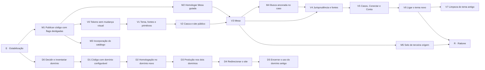

# ForgeLex — Plano unificado de execução

**Versão 3 · 11 de novembro de 2026 · Elaborado para aprovação de Boni**

> Este é o único plano vigente do ForgeLex. Ele substitui o plano v2 da Mesa guiada (10/11/2026), cujo conteúdo foi
> incorporado aqui, e o plano de reestruturação visual e integração com o Ratione elaborado em 09/11/2026 fora do
> repositório. Os planos anteriores em `docs/superpowers/plans/` permanecem como histórico e não abrem tarefas novas.
> Boni é o único avaliador e aprovador humano ([AGENTS.md](../../../AGENTS.md)). Cada etapa só começa com a
> autorização dele, e commit, push, migração e deploy seguem o escopo que ele conceder.

## 0. Como usar este plano

1. **Uma etapa por vez, uma PR por etapa.** Cada etapa tem objetivo, dependências, arquivos, passos, verificação,
   aceite e reversão. Uma PR não mistura frentes.
2. **Nada muda para o cliente sem flag.** Fluxo novo, tema novo e domínio novo entram desligados ou em paralelo ao
   atual, e são ligados por configuração, com reversão pela mesma configuração.
3. **Registro único de execução.** Toda etapa concluída registra HEAD, arquivos, comandos, resultados e riscos
   residuais em [`docs/architecture/2026-11-10-mesa-guiada-execucao.md`](../../architecture/2026-11-10-mesa-guiada-execucao.md),
   numa seção com o código da etapa (E1, V0, D1…). Não criar novo arquivo de registro, plano ou checklist.
4. **Estado publicado** continua em `PENDENCIAS.md` (seção “Estado publicado atual”), atualizado a cada deploy.
5. **Marcar o progresso aqui.** Ao concluir uma etapa, marcar os itens `[x]` e acrescentar uma linha de evidência com
   link para a seção do registro. Uma decisão nova de Boni entra na seção 2, com data.
6. **Publicações de risco separadas.** A troca de tema (V6) e a virada de domínio (D3/D4) nunca saem na mesma
   publicação nem na mesma semana.

## 1. Ponto de partida

| Item                         | Situação em 11/11/2026                                                                                                                                                                                                             |
| ---------------------------- | ---------------------------------------------------------------------------------------------------------------------------------------------------------------------------------------------------------------------------------- |
| `main`                       | `df8c714` (PR #137). 30 commits após `a44035e`, quase todos da Mesa guiada.                                                                                                                                                        |
| Verificação local            | Build, tipos, lint e Prettier aprovados. Vitest: 2.014 aprovados e 17 ignorados (dependem de PostgreSQL). Playwright: 6/6 da orientação e 37/37 da Mesa e revisão (este último exige ambiente com locale UTF-8; ver E7).           |
| Não verificado nesta revisão | Ensaios PostgreSQL, demais suítes Playwright, produção.                                                                                                                                                                            |
| Produção documentada         | `5757733` em `PENDENCIAS.md`. Os PRs #132 a #137 foram integrados depois e não têm registro de publicação.                                                                                                                         |
| Flags                        | Mesa agêntica, casos e pesquisa salva com padrão `false` no `cloudbuild.yaml`. `FORGELEX_DESK_GUIDANCE_ENABLED` e `FORGELEX_DRAFT_SAVE_COMMANDS_ENABLED` não aparecem em `ops/gcp`.                                                |
| Visual atual                 | Paleta `ivory`, `cognac`, `champagne` e tons `stone` do Tailwind; Georgia e Inter. Uso medido: 824 classes `stone`, 243 `cognac`, 96 `champagne`, 10 `ivory`, 79 `amber`, 50 `emerald` e 48 cores hexadecimais literais em `.tsx`. |
| Domínio atual                | `nexojuris.ia.br` (produção) e `hml.nexojuris.ia.br`. 165 referências no repositório, em código, testes, ops e documentação.                                                                                                       |

## 2. Decisões de Boni

As etapas indicadas não começam enquanto a decisão estiver aberta. A recomendação é técnica e não substitui a decisão.

| ID    | Decisão                                                                                                                       | Recomendação                                                                                                                                                                      | Bloqueia           |
| ----- | ----------------------------------------------------------------------------------------------------------------------------- | --------------------------------------------------------------------------------------------------------------------------------------------------------------------------------- | ------------------ |
| DEC-1 | Nome exato do domínio novo e do subdomínio de homologação (grafia “ForgeLex” ou “Forglex”, extensão `.com.br`, `.ia.br` etc.) | Registrar a mesma grafia da marca; reservar também a grafia alternativa para redirecionar                                                                                         | D2 em diante       |
| DEC-2 | Paleta do tema novo                                                                                                           | **Decidido por Boni em 11/11/2026:** branco gelo com petróleo, conforme o protótipo de 09/11 (seção 7.1). Substitui a diretriz do v2 de preservar `ivory`, `cognac` e `champagne` | Nada               |
| DEC-3 | Tipografia                                                                                                                    | Spectral (títulos e texto jurídico) e Inter (interface), hospedadas no próprio site, sem dependência de terceiros                                                                 | V1                 |
| DEC-4 | Origem do catálogo de habilidades                                                                                             | **Decidido por Boni em 11/11/2026:** manter e incorporar as 2.077 fichas capturadas (MinutaIA), com origem e hash registrados. Substitui a recomendação de catálogo próprio       | Nada (M3 liberada) |
| DEC-5 | Reserva de R$ 11,50 por trabalho comercial (PR #135, antes R$ 5,00)                                                           | Confirmar a regra e exibi-la na Conta e na confirmação de custo                                                                                                                   | M1                 |
| DEC-6 | Tarifa da análise de aderência na busca ancorada                                                                              | Gerar a frase de aderência na mesma chamada da pesquisa, sem tarifa adicional, enquanto o uso real é medido                                                                       | M4                 |
| DEC-7 | Título principal do site público                                                                                              | Manter o título aprovado travado em `tests/public-copy.test.ts`; o título do protótipo não entra                                                                                  | V2                 |
| DEC-8 | Destino do Ratione (`ratione.nexojuris.ia.br`) na troca de domínio                                                            | Manter onde está até a Frente R; decidir junto com o modelo de produto (dois produtos ligados ou um só)                                                                           | D5 e Frente R      |
| DEC-9 | Arquivamento dos planos antigos de `docs/superpowers/plans/`                                                                  | Mover os concluídos para `docs/historico/planos/`, preservando links                                                                                                              | E6                 |

## 3. O que já está concluído (herdado do v2)

O plano v2 definiu a Mesa guiada: perguntas objetivas com opção “Não sei”, seleção interna de habilidades no
servidor, nada do catálogo exposto ao usuário. As etapas abaixo têm código e validação local registrados.
Os contratos, princípios e critérios A01–A19 continuam valendo e estão no Apêndice A.

| Etapa v2 | Entrega                                                                             | Situação                                                          |
| -------- | ----------------------------------------------------------------------------------- | ----------------------------------------------------------------- |
| R0       | Baseline e protocolo v11 opt-in                                                     | Concluída                                                         |
| R1       | Inventário técnico das 2.077 fichas (303 Forma, 1.774 Matéria), fora do repositório | Concluída. Incorporação em M3                                     |
| R2       | Contratos `desk-guidance`, `GuidanceSnapshot`, `SkillBinding` e hashes              | Concluída                                                         |
| R3       | Orientação persistida antes da inferência, rotas `/api/agentic/guidance`            | Concluída                                                         |
| R4       | Seleção única da Mesa e URL (`desk-selection.ts`, `desk-location.ts`)               | Concluída. Defeito de compatibilidade em E2                       |
| R5       | Resolvedor e vínculo de habilidades                                                 | Concluída com fichas sintéticas                                   |
| R6       | `GuidedQuestion`, `GuidanceSummary`, `GuidancePanel`                                | Concluída. Aceite visual migra para V3                            |
| R7       | Interpretação no fluxo agêntico e hipótese confirmável                              | Concluída                                                         |
| R8       | Edição delimitada sobre versão e hash (protocolo v12)                               | Concluída                                                         |
| R9       | Pesquisa salva e fontes na Mesa                                                     | Concluída. Base da busca ancorada (M4)                            |
| R10      | Revisão, aprovação e histórico na Mesa                                              | Concluída                                                         |
| R11      | Salvamento atômico com recibo (`persistence-0041-draft-save-commands`)              | Concluída em código. Migração manual pendente (E4)                |
| R12      | Manifesto real, contexto medido e controles financeiros                             | Concluída                                                         |
| R13      | Regressão integrada e exposição pública                                             | Concluída localmente                                              |
| R14      | Piloto Penal e regressão Cível                                                      | Técnica concluída com fichas sintéticas. Incorporação vai para M3 |
| R15      | Expansão por área                                                                   | Suspensa por decisão de 11/11/2026. Reabertura depende de M3      |

## 4. Frentes e ordem



A Frente V e a Frente D andam em paralelo depois de E. A sequência sugerida, sem prazo fixo: E, M1, V0, D0, D1, V1,
M2, M3, V2, D2, V3, M4, V4, D3, D4, V5, V6, V7, D5. A Frente R só começa quando V6 estiver estável.

## 5. Etapa E — estabilização

Objetivo: corrigir os defeitos da revisão de 11/11 e alinhar documentação e operação ao código antes de qualquer
mudança de produto.

### E1 — Registrar o estado publicado real

- [ ] Ler a revisão ativa dos serviços `forgelex-api-prod` e `forgelex-closure-hml-private` (`FORGELEX_SOURCE_SHA`).
- [ ] Atualizar a seção “Estado publicado atual” de `PENDENCIAS.md` e reescrever como “publicado” ou “integrado, não
      publicado” as linhas que ainda dizem “ainda não publicado” para os PRs #132 a #135.
- [ ] Registrar o padrão efetivo das flags de produção e homologação.

**Aceite.** `PENDENCIAS.md` descreve exatamente o que está no ar. **Reversão.** Não se aplica.

### E2 — URL da Mesa em navegadores sem `URLSearchParams.size`

Defeito: `apps/web/src/navigation/desk-location.ts:32` decide pela propriedade `query.size`, ausente no Safari e iOS
anteriores ao 17 e no Chrome anterior ao 113. Nesses navegadores a URL sai sem caso, peça e conversa, e recarregar ou
voltar perde a seleção. O mesmo padrão existe em `apps/web/src/navigation/routes.ts:80`, que descarta os parâmetros
de retorno.

- [ ] Teste que remove `size` de `URLSearchParams.prototype` e confere `deskLocation` e a preservação em `routes.ts`.
- [ ] Trocar a decisão por `query.toString()` (string vazia quando não há parâmetros) e fazer o mesmo em `routes.ts`.
- [ ] Procurar outros usos de API recente sem fallback (`rg "\.size\b|structuredClone|Array\.prototype\.at"` no web).

**Verificação.** `desk-location.test.ts`, testes de rotas, `playwright.writing-desk.config.ts`.
**Aceite.** URL idêntica com e sem a propriedade. **Reversão.** Reverter o commit.

### E3 — Verificação periódica da chave do provedor

Defeito: `ProviderKeyMonitor` só consulta a OpenAI quando alguém acessa `/readyz`, e nada no repositório chama
`/readyz` periodicamente em produção (só o deploy). O alerta `provider.key_invalid` pode nunca disparar.

- [ ] Conferir no Cloud Run se há sonda de prontidão ou de vida apontando para `/readyz`.
- [ ] Se não houver, criar `ops/gcp/production/provision-readiness-check.ps1` com Cloud Monitoring Uptime Check (ou
      Cloud Scheduler) chamando `/readyz` a cada 5 minutos, idempotente e com remoção documentada.
- [ ] Ensaio em homologação com chave inválida, confirmando o log e o e-mail do alerta.
- [ ] Documentar em `ops/gcp/production/README.md`, na seção do alerta já existente.

**Aceite.** Uma chave inválida gera alerta em até 15 minutos sem ação de cliente. **Reversão.** Remover a checagem.

### E4 — Flags e migração da Mesa guiada no roteiro de deploy

- [ ] Declarar `FORGELEX_DESK_GUIDANCE_ENABLED=false` e `FORGELEX_DRAFT_SAVE_COMMANDS_ENABLED=false` no
      `cloudbuild.yaml` e nos scripts de deploy, com o mesmo tratamento das demais flags.
- [ ] Incluir no `ops/gcp/production/README.md` a ordem obrigatória: migração `0041` (procedimento em
      [`draft-save-recovery.md`](../../operations/draft-save-recovery.md)) antes de ligar
      `FORGELEX_DRAFT_SAVE_COMMANDS_ENABLED`. A API recusa subir com a flag ligada e sem a tabela; isso é intencional.

**Aceite.** Deploy com valores explícitos e roteiro com a ordem. **Reversão.** Flags em `false`.

### E5 — Área digitada no resumo da orientação

Defeito: quando o usuário escreve a área em vez de escolher uma opção, a resposta vira `unknown` e o resumo mostra
“Área a definir”. Só o texto livre da tarefa reaparece como `description` em `guidance-service.ts`.

- [ ] Teste no serviço: resposta de área com texto livre aparece na projeção pública.
- [ ] Projetar o texto livre mais recente de cada campo (`detail`) a partir das mensagens, sem alterar o snapshot nem
      o `guidanceHash`.
- [ ] Exibir em `GuidanceSummary` (“Área: previdenciário, a confirmar”).

**Aceite.** O que o usuário escreveu aparece no resumo, e o estado continua `unknown` até a confirmação.
**Reversão.** Reverter o commit; o snapshot não muda.

### E6 — Higiene documental

- [ ] Com DEC-9, mover os planos concluídos de `docs/superpowers/plans/` para `docs/historico/planos/` e atualizar
      os links (`rg -l "superpowers/plans"`).
- [ ] Atualizar o link do registro de execução para este plano.

### E7 — Robustez dos testes de interface

- [ ] Definir `LANG=C.UTF-8` e `LC_ALL=C.UTF-8` nos jobs Playwright da CI e documentar em `README.md`. Sem isso,
      Chromium em Linux nomeia como `download` o arquivo de título acentuado e o teste de exportação Word falha.

**Verificação da etapa E.** `pnpm typecheck`, `pnpm lint`, `pnpm exec vitest run`,
`pnpm exec playwright test --config playwright.writing-desk.config.ts` e `--config playwright.desk-guidance.config.ts`.

## 6. Frente M — Mesa guiada: fechamento e busca ancorada

### M1 — Publicar o código integrado com flags desligadas

Depende de E1, E4 e DEC-5.

- [ ] Deploy de `main` (com E) por `deploy-from-main.ps1`, flags da Mesa guiada e do salvamento desligadas.
- [ ] Conferir no `mcp.call` o efeito do #132 (chave de idempotência em `required`) no Claude e no ChatGPT, e o piso
      de 5 decisões por pesquisa.
- [ ] Conferir a reserva de R$ 11,50 numa execução comercial de teste e a mensagem de saldo insuficiente.

**Aceite.** Produção sem mudança visível para o cliente, exceto o que DEC-5 aprovar. **Reversão.** Tráfego para a
revisão anterior (`--to-revisions=...=100`).

### M2 — Homologar a Mesa guiada (A18)

- [ ] Aplicar a migração `0041` em homologação, com backup registrado.
- [ ] Ligar `FORGELEX_DESK_GUIDANCE_ENABLED` e `FORGELEX_DRAFT_SAVE_COMMANDS_ENABLED` em homologação.
- [ ] Percorrer: pedido completo, “Me ajude a começar”, “Não sei”, correção pelo resumo, duas abas, recarga, criação,
      revisão sem nova versão, edição delimitada, pesquisa salva, salvamento com perda de resposta simulada.
- [ ] Registrar o resultado funcional. O aceite visual (A19) passa a ser feito em V3, no tema novo.

**Aceite.** A18 registrado em homologação. Ligar em produção é decisão separada de Boni, depois de V3.

### M3 — Incorporação do catálogo de habilidades

Decisão de Boni (DEC-4, 11/11/2026): as 2.077 fichas capturadas (303 Forma, 1.774 Matéria) são mantidas e incorporadas.
O R1 já validou o ZIP (SHA-256 no registro de execução), o manifesto, as contagens e os hashes.

- [ ] Definir a forma de incorporação: onde o conteúdo fica (fora dos assets públicos e do bundle do navegador),
      como o servidor o carrega e como a versão do catálogo é fixada por execução.
- [ ] Gravar em cada ficha incorporada a origem (MinutaIA), a versão original, o hash original e a data da decisão.
      Descrever apenas condições de reutilização que existam de fato, sem criar exigência de terceiro.
- [ ] Transformar o inventário do R1 em catálogo consultável pelo resolvedor (R5), mantendo os 2.077 registros
      rastreáveis e os itens ambíguos com estado explícito.
- [ ] Aplicar às quatro fichas do piloto os ajustes da conferência amostral
      ([registro](../architecture/2026-11-10-mesa-guiada-execucao.md#avaliação-das-quatro-fichas-capturadas)) como
      nova versão elegível, preservando a versão original e as execuções anteriores.
- [ ] Definir com Boni o subconjunto elegível do piloto; a seleção técnica e a avaliação jurídica têm campos próprios.
- [ ] Manter `tests/fixtures/desk-pilot-revised/*` e as fichas sintéticas autorais dos testes de regressão.
- [ ] Repetir o piloto R14 (`playwright.desk-pilot.config.ts`) com o catálogo incorporado e com os limites de
      contexto do R12.
- [ ] Reabrir R15 (expansão por área) com nova decisão de Boni, usando as métricas do piloto.

**Aceite.** 2.077 fichas incorporadas e rastreáveis, sem exposição de conteúdo, título, ID ou hash na interface (A02).
Piloto Penal e regressão Cível aprovados por Boni. **Reversão.** Catálogo versionado: voltar à versão anterior
preserva as execuções já registradas.

## 7. Frente V — refatoração visual

Objetivo: levar o ForgeLex ao sistema branco gelo do protótipo de 09/11, sem quebrar seletores de teste, rotas ou
contratos, com tema trocável por configuração até a limpeza final.

### 7.1 Especificação de tokens (tema “gelo”)

| Token semântico | Uso                                              | Gelo              | Contraste medido                 |
| --------------- | ------------------------------------------------ | ----------------- | -------------------------------- |
| `canvas`        | fundo da aplicação                               | `#F4F7F8`         | —                                |
| `surface`       | cartões, painéis, editor                         | `#FFFFFF`         | —                                |
| `surface-muted` | cabeçalho translúcido, áreas secundárias         | `#F7FAFB`         | —                                |
| `line`          | divisórias e bordas decorativas                  | `#E2E8EB`         | decorativo                       |
| `line-control`  | borda de campo, botão fantasma, caixa de seleção | `#7E8B92`         | 3,50:1 no branco, 3,25:1 no gelo |
| `ink`           | títulos e texto principal                        | `#101619`         | 16,95:1 no gelo                  |
| `ink-soft`      | corpo de texto longo                             | `#2A363C`         | 11,37:1 em `accent-soft`         |
| `muted`         | texto de apoio                                   | `#4C585F`         | 6,80:1 no gelo                   |
| `subtle`        | metadados e legendas                             | `#67727A`         | 4,57:1 no gelo, 4,92:1 no branco |
| `accent`        | ação principal, links, foco                      | `#0F5C6E`         | branco sobre ele 7,56:1          |
| `accent-strong` | hover e títulos de destaque                      | `#0B4552`         | 9,68:1 em `accent-soft`          |
| `accent-soft`   | fundo de destaque, citação                       | `#F0F6F7`         | —                                |
| `ok`            | selo verificada                                  | `#1F6B4C`         | 6,43:1 no branco                 |
| `warn`          | lacunas e pendências                             | `amber-700` atual | conferir em V1                   |
| `danger`        | erro e exclusão                                  | `red-700` atual   | conferir em V1                   |

Tipografia (DEC-3): Spectral 400/500/600 para títulos, ementas e texto da peça; Inter 400/500/600 para interface.
Raios: 10 px em controles, 16 a 18 px em cartões. Foco: contorno de 2 px em `accent` com 2 px de afastamento.
Alvos de toque mínimos de 44 × 44 px. Borda de controle sempre em `line-control`, nunca em `line` (WCAG 1.4.11).

### 7.2 Composição por tela (do protótipo)

| Tela                 | Composição                                                                                                                                                                                                                                                                                             |
| -------------------- | ------------------------------------------------------------------------------------------------------------------------------------------------------------------------------------------------------------------------------------------------------------------------------------------------------ |
| Casca                | Lateral com Mesa, Casos, Jurisprudência e conta no rodapé; cabeçalho translúcido; “Andamento processual” no lugar de “Consulta processual”                                                                                                                                                             |
| Mesa                 | Desktop em três áreas (v2 §9.1): conversas recolhíveis, conversa com resumo do pedido e pergunta ativa, peça ou fonte aberta. Seletor de caso no cabeçalho com “Sem caso — somente texto”. Painel da peça com abas Texto, Fontes e Revisão. Etapas do trabalho visíveis. Celular: abas Conversa e Peça |
| Estado vazio da Mesa | Campo de conversa, “Me ajude a começar”, exemplos e explicação curta dos dois selos                                                                                                                                                                                                                    |
| Sem caso             | Lista de fontes comum e ação “Criar caso a partir desta conversa”                                                                                                                                                                                                                                      |
| Jurisprudência       | Busca comum ou ancorada (M4), aderência por resultado, verificação gratuita                                                                                                                                                                                                                            |
| Leitor de decisão    | Ementa em Spectral, proveniência, selo verificada, bloco de aderência ao caso, “Onde esta decisão já aparece”, citação formatada                                                                                                                                                                       |
| Casos                | Linha de situação e cobertura das questões (verificadas e lacunas)                                                                                                                                                                                                                                     |
| Caso novo            | Só o nome é obrigatório; importar PDF ou colar texto; “Outros jeitos de começar” (pela Mesa, pela IA via MCP)                                                                                                                                                                                          |
| Visão                | Cartão “Primeiros passos” que pode ser ocultado                                                                                                                                                                                                                                                        |
| Conectar e Conta     | Estado da conexão sem custo; saldo, extrato e custos por operação vindos do serviço                                                                                                                                                                                                                    |

### 7.3 Estratégia técnica

O tema novo entra por variáveis CSS e atributo `data-theme` no `<html>`. Os nomes atuais (`ivory`, `cognac`,
`champagne`, `stone`) passam a apontar para variáveis, então as 1.173 classes existentes mudam de cor juntas quando o
tema muda, sem reescrever telas. Só depois do tema estabilizado as classes migram para nomes semânticos (V7).

### V0 — Tokens sem mudança visual

- [ ] Capturar screenshots de referência (desktop 1440 px e celular 390 px) de Entrar, site público, Visão, Mesa vazia,
      Mesa com peça, Jurisprudência, leitor, Casos, Conectar e Conta. Guardar fora do Git; registrar o local.
- [ ] Em `index.css`, criar variáveis RGB (`--fl-canvas: 248 246 240` etc.) para todos os tons usados: `ivory`
      50–300, `cognac` 50–900, `champagne`, `stone` 50–950 (todos os 11 tons estão em uso), `amber` e `emerald` usados.
      Valores do tema `classico` idênticos aos atuais.
- [ ] Em `tailwind.config.js`, apontar `ivory`, `cognac`, `champagne` e `stone` para `rgb(var(--x) / <alpha-value>)` e
      acrescentar os nomes semânticos da 7.1 apontando para as mesmas variáveis.
- [ ] Substituir as 48 cores hexadecimais literais em `.tsx` por tokens (inclui `bg-[#FDFBF7]` do editor).
- [ ] Sombras `card` e `card-hover` com cor por variável.

**Verificação.** Screenshots antes e depois comparados pixel a pixel (`toHaveScreenshot` local, não versionado);
Vitest, lint, `axe` e as suítes Playwright da Mesa e do site público.
**Aceite.** Diferença visual zero. **Reversão.** Reverter o commit.

### V1 — Tema gelo, fontes e primitivos

Depende de V0 e DEC-3.

- [ ] Bloco `[data-theme="gelo"]` em `index.css` com os valores da 7.1 e mapeamento dos tons legados para os tons gelo
      equivalentes (tabela no registro de execução).
- [ ] `VITE_FORGELEX_THEME` (`classico` padrão, `gelo`) aplicado no `index.html` antes da primeira pintura. Em
      homologação, prévia por `?tema=gelo` guardada em `localStorage` (com `try/catch`); desativada em produção.
- [ ] Spectral e Inter em `woff2` no próprio site (`public/fonts`), subconjunto latino, `font-display: swap`,
      `preload` só da Inter 400; conferir CSP `font-src 'self'`.
- [ ] Primitivos em `index.css` (`.btn-primary`, `.btn-secondary`, `.input-control`, cartão, selo, foco) usando só
      tokens semânticos.
- [ ] Medir contraste de todos os pares usados com script (registro com a tabela).

**Aceite.** Tema `classico` inalterado; tema `gelo` sem violação `axe` nas telas da V0.
**Reversão.** `VITE_FORGELEX_THEME=classico`.

### V2 — Casca e site público

Depende de V1 e DEC-7.

| Entrega                                         | Arquivos                              | Aceite                                                                    |
| ----------------------------------------------- | ------------------------------------- | ------------------------------------------------------------------------- |
| Lateral com Mesa, Casos, Jurisprudência e conta | `Sidebar.tsx`, `navigation/routes.ts` | Aliases antigos (Rascunhos, Revisão) continuam redirecionando para a Mesa |
| Cabeçalho enxuto                                | `Header.tsx`                          | Nenhum item leva a ferramenta removida                                    |
| Entrar, Produto e páginas públicas              | telas públicas                        | `public-copy.test.ts` e `public-seo.test.ts` verdes                       |
| Visão com “Primeiros passos” ocultável          | tela de visão geral                   | Estado persiste por usuário                                               |
| “Andamento processual”                          | rotas e rótulos                       | Testes de cópia atualizados no mesmo commit; rota antiga redireciona      |

**Verificação.** `playwright.public.config.ts`, `accessibility.spec.ts`, suíte da Mesa nos dois temas.

### V3 — Mesa

Depende de V2 e M2. É a maior etapa; entregar em duas PRs (composição e abas; depois seletor de caso e estados).

| Entrega                                                                  | Arquivos                                                                      | Aceite                                                               |
| ------------------------------------------------------------------------ | ----------------------------------------------------------------------------- | -------------------------------------------------------------------- |
| Composição em três áreas e abas Conversa/Peça abaixo de `lg`             | `WritingDeskScreen.tsx`, `AgenticWorkspaceScreen.tsx`                         | Buffer da peça preservado ao abrir fonte, responder ou trocar de aba |
| Painel da peça com abas Texto, Fontes, Revisão                           | `DraftStudioScreen.tsx`, `DraftCanvas`, `ReviewPanel`, `EditorialReviewPanel` | Revisão cria zero versões (A09); aplicar aceitas cria uma            |
| Orientação no tema novo                                                  | `GuidedQuestion`, `GuidanceSummary`, `GuidancePanel`, `QuestionOptions`       | Uma pergunta ativa; “Não sei” visível como estado                    |
| Seletor de caso e “Sem caso — somente texto”                             | cabeçalho da Mesa, `desk-selection.ts`                                        | Trocar caso não aplica decisão de outra conversa (A07)               |
| “Criar caso a partir desta conversa”                                     | Mesa e `/api/v2/matters`                                                      | Caso nasce só com nome                                               |
| Etapas do trabalho a partir de STATUS, QUESTION, DELIVERY, SOURCE, ERROR | `agentic-workspace/*`                                                         | ERROR sempre visível e anunciado                                     |
| Estado vazio com exemplos e os dois selos                                | `Composer.tsx`                                                                | Primeiro uso sem documentação                                        |

- [ ] Rótulos e papéis ARIA usados pelos testes mantidos; qualquer mudança de texto atualiza o teste no mesmo commit.
- [ ] Capturas desktop e celular para Boni: **A19 é decidido aqui.**

### V4 — Jurisprudência, leitor e fontes

Depende de V3 e M4. `ResearchDeskScreen.tsx`, `DecisionReader`, `SavedResearchPanel`, `DeskCaseSources`,
`SaveAuthorityToCase`. Linguagem visual única para os selos: verificada (verde, ícone e texto), análise da IA
(petróleo, rotulada), origem externa (M5).

### V5 — Casos, Caso novo, Conectar e Conta

Telas da 7.2. Remover ou dar comportamento real aos botões inertes. Valores financeiros sempre vindos do serviço.

### V6 — Ligar o tema gelo

- [ ] Passada completa em 360, 768 e 1440 px; `axe` em todas as telas; leitor de tela nos eventos da Mesa.
- [ ] Favicon, imagem Open Graph e cores de `theme-color` no tema novo.
- [ ] `VITE_FORGELEX_THEME=gelo` em homologação, depois em produção, em publicação isolada (seção 0, item 6).

**Reversão.** `VITE_FORGELEX_THEME=classico` e novo deploy do web.

### V7 — Limpeza

Depois de ao menos duas semanas de V6 sem reversão.

- [ ] Migrar classes `ivory`, `cognac`, `champagne` e `stone` para nomes semânticos, por tela, com screenshots iguais.
- [ ] Remover o tema `classico`, a flag e os tons legados do `tailwind.config.js`.
- [ ] Teste ou regra de lint que impeça cor literal nova em componentes.

## 8. Frente D — mudança de domínio

Objetivo: levar site, API, MCP e OAuth para o domínio novo sem quebrar conexões existentes de ChatGPT e Claude,
pagamentos em curso, login nem SEO. O domínio antigo continua respondendo por um período e nunca deixa de ser
renovado.

### D0 — Decisão e inventário

Depende de DEC-1.

- [ ] Registrar o domínio no Registro.br em nome de Boni; reservar a grafia alternativa.
- [ ] Inventário completo e registrado: `rg -n "nexojuris" --glob '!**/dist/**'` (165 ocorrências em 11/11), mais o que
      fica fora do repositório:

| Sistema           | O que muda                                                                                                                                                                            |
| ----------------- | ------------------------------------------------------------------------------------------------------------------------------------------------------------------------------------- |
| Registro.br e DNS | Registros A/AAAA do balanceador, CAA para o emissor do certificado                                                                                                                    |
| GCP               | Certificado gerenciado com os dois domínios, regras de host no balanceador, revisões de homologação                                                                                   |
| Supabase Auth     | Site URL, Redirect URLs (antigo e novo durante a transição), servidor OAuth com caminho `/oauth/consent`, links dos e-mails                                                           |
| Login social      | Origens e redirecionamentos autorizados no provedor, se houver                                                                                                                        |
| MCP e OAuth       | `FORGELEX_PUBLIC_URL`, `FORGELEX_MCP_RESOURCE_URL`, metadados `/.well-known/oauth-protected-resource/mcp`; conectores já criados no ChatGPT e no Claude apontam para o domínio antigo |
| Mercado Pago      | URL de notificação; pagamentos criados antes da virada notificam o domínio antigo                                                                                                     |
| CORS              | `FORGELEX_ALLOWED_ORIGINS`                                                                                                                                                            |
| SEO               | `index.html` (canonical, `og:url`), `sitemap.xml`, `robots.txt`, `public-metadata.ts`, Search Console                                                                                 |
| Ratione           | `ratione.nexojuris.ia.br` (DEC-8)                                                                                                                                                     |
| Documentação      | `ops/gcp/production/README.md`, runbooks e registros vigentes; registros históricos mantêm o domínio da época                                                                         |

### D1 — Código com domínio configurável e duplo

Sem mudança de infraestrutura nem de comportamento em produção.

- [ ] Web: `CANONICAL_ORIGIN` a partir de `VITE_PUBLIC_ORIGIN` (obrigatória no build de produção); `index.html` com
      `%VITE_PUBLIC_ORIGIN%`; `sitemap.xml` e `robots.txt` gerados no build.
- [ ] API: `FORGELEX_MCP_RESOURCE_URLS` (lista) além do valor único atual. Metadados de recurso devolvidos conforme o
      host da requisição; validação de token aceita qualquer recurso da lista. Teste com os dois hosts e com recurso
      fora da lista (`RESOURCE_MISMATCH`).
- [ ] `mcp.call` passa a registrar o host, para medir o uso do domínio antigo.
- [ ] Testes: centralizar o domínio de fixture numa constante de teste e trocar as ocorrências.
- [ ] Scripts de ops com o domínio por parâmetro, sem valor padrão de produção embutido.

**Aceite.** Com as variáveis atuais, comportamento idêntico (testes de OAuth, MCP e SEO verdes).
**Reversão.** Reverter o commit; nenhuma configuração externa mudou.

### D2 — Homologação no domínio novo

- [ ] DNS e certificado de `hml.<domínio novo>`; regras do balanceador.
- [ ] Supabase de homologação com as duas origens.
- [ ] Ensaio completo: login, OAuth do MCP no Claude e no ChatGPT com o host novo, conexão antiga continuando a
      funcionar, pagamento de teste com notificação, pesquisa, Mesa.

**Aceite.** Os dois domínios funcionam em homologação. **Reversão.** Remover o host novo do balanceador.

### D3 — Produção nos dois domínios

- [ ] Certificado com os dois domínios, DNS do novo, `FORGELEX_MCP_RESOURCE_URLS` com os dois, CORS com os dois,
      Supabase com as duas origens.
- [ ] Domínio novo passa a ser o canônico (`FORGELEX_PUBLIC_URL`, `VITE_PUBLIC_ORIGIN`); notificação do Mercado Pago
      aponta para o novo.
- [ ] Tela Conectar mostra a URL nova e orienta a reconexão.

**Aceite.** Conexões MCP antigas e novas funcionam; pagamentos novos notificam o domínio novo.
**Reversão.** Voltar o canônico para o antigo; os dois continuam servidos.

### D4 — Redirecionar o site

- [ ] No domínio antigo, redirecionamento 301 só para páginas do site (`GET` de HTML), preservando caminho e query.
- [ ] Sem redirecionamento para `/mcp`, `/oauth/*`, `/.well-known/*`, `/api/*` e notificações de pagamento, que
      continuam servidos no domínio antigo.
- [ ] Search Console: propriedade nova e mudança de endereço.

**Aceite.** Páginas antigas chegam ao domínio novo; nenhuma chamada de máquina quebra.

### D5 — Encerrar o uso do domínio antigo

- [ ] Acompanhar o host no `mcp.call` e nas notificações até o uso antigo chegar a zero por 30 dias.
- [ ] Comunicar data limite aos usuários com conector antigo.
- [ ] Remover o recurso antigo de `FORGELEX_MCP_RESOURCE_URLS` e as origens antigas do Supabase.
- [ ] Manter o redirecionamento do site e **renovar o domínio antigo indefinidamente**; um domínio vencido poderia ser
      registrado por terceiro e receber retornos de OAuth.

## 9. Frente R — integração com o Ratione (posterior)

Começa depois de V6 estável e de M5. Integração por contrato entre serviços, sem fundir repositórios.

| Etapa | Entrega                                                                                               | Aceite                                                                   |
| ----- | ----------------------------------------------------------------------------------------------------- | ------------------------------------------------------------------------ |
| R-a   | Auditoria: mesmo projeto Supabase ou não, rotas e parâmetros do PrazoZero, NormaViva e TeseMap        | Registro com a resposta                                                  |
| R-b   | Links profundos: artigo citado → NormaViva; tema ou súmula → TeseMap; movimentação → PrazoZero        | Nenhum dado do caso na URL                                               |
| R-c   | API de serviço somente leitura no Ratione (prazo, norma na data, precedentes por tema ou dispositivo) | Determinística, versionada, autenticação entre servidores                |
| R-d   | Selos de origem Ratione na aba Fontes (M5)                                                            | Fonte e data visíveis; STF como fonte Ratione, não como pesquisa cobrada |
| R-e   | Funções equivalentes no MCP do ForgeLex                                                               | Separadas de `research_*` e do módulo de agentes comerciais              |
| R-f   | Argumenta no “Analisar documento” e conta única                                                       | Só com decisão de produto (DEC-8) e política de retenção                 |

## 10. Verificação padrão de cada etapa

```powershell
pnpm typecheck
pnpm lint
pnpm format:check:code
pnpm exec vitest run
pnpm exec playwright test --config playwright.writing-desk.config.ts
pnpm exec playwright test --config playwright.desk-guidance.config.ts
pnpm test:e2e:public
pnpm test:e2e:accessibility
```

Acrescentar as suítes PostgreSQL (`test:postgres:agentic-runtime`, `test:postgres:agentic-case-task`) quando a etapa
tocar persistência ou execução, e as suítes de MCP e OAuth (`test:e2e:mcp-site`, `scripts/smoke-mcp-oauth.mjs`) nas
etapas D. Falhas preexistentes e testes ignorados são registrados sem contar como aprovação.

## 11. Riscos

| Risco                                                 | Mitigação                                                                        | Etapa      |
| ----------------------------------------------------- | -------------------------------------------------------------------------------- | ---------- |
| Tema novo quebra seletores de teste                   | Testes localizam por papel e rótulo; texto alterado muda o teste no mesmo commit | V0–V5      |
| Diferença visual não intencional ao introduzir tokens | Screenshots pixel a pixel em V0                                                  | V0         |
| Contraste insuficiente em bordas de controle          | `line-control` com 3,5:1; medição por script                                     | V1         |
| Fontes externas lentas ou bloqueadas                  | Fontes no próprio site e `font-display: swap`                                    | V1         |
| Conectores MCP antigos param na troca de domínio      | Recurso duplo, sem redirecionar `/mcp` e OAuth, desligamento só com uso zero     | D1–D5      |
| Notificação de pagamento perdida                      | Domínio antigo continua servindo notificações                                    | D3–D5      |
| Domínio antigo registrado por terceiro                | Renovação indefinida                                                             | D5         |
| Fichas com erro jurídico ou de escopo                 | Ajustes da conferência amostral em nova versão; avaliação de Boni por lote       | M3         |
| Reserva de R$ 11,50 impede uso com saldo baixo        | DEC-5 e mensagem clara                                                           | M1         |
| Alerta de chave não dispara                           | Checagem periódica de `/readyz`                                                  | E3         |
| Duas mudanças de risco juntas                         | Seção 0, item 6                                                                  | V6, D3, D4 |

## 12. Referências

- Protótipo interativo do novo visual (canvas de 09/11/2026, privado de Boni): fonte da seção 7.1 e 7.2.
- Registro de execução: [`docs/architecture/2026-11-10-mesa-guiada-execucao.md`](../../architecture/2026-11-10-mesa-guiada-execucao.md).
- Salvamento atômico: [`docs/operations/draft-save-recovery.md`](../../operations/draft-save-recovery.md).
- Estado publicado: [`PENDENCIAS.md`](../../../PENDENCIAS.md).

## Apêndice A — Mesa guiada: decisões, contratos e critérios herdados do v2

### A.1 Decisões de produto

- A condução ocorre por perguntas seletivas e objetivas, uma ativa por vez, com texto livre no mesmo compositor.
- “Não sei” é resposta válida e persistida; a IA ajuda a identificar o contexto e a hipótese material exige
  confirmação.
- A área influencia as perguntas seguintes; Forma, Matéria, especialistas e ferramentas são escolhidos no servidor.
- Habilidades, hashes e identificadores internos ficam nos bastidores.
- Cliques em opções determinísticas não chamam provedor nem reservam saldo; inferências seguem consentimento e custo
  vigentes.
- Penal é a jornada principal do piloto; Cível é a regressão.

### A.2 Contratos

`GuidanceSnapshot`, `DecisionValue` e `SkillBinding` estão em `packages/domain/src/contracts/desk-guidance.ts`, com
regras em `packages/legal-workflows/src/desk-guidance/guidance-rules.ts` (`mesa-v2`) e serviço em
`apps/api/src/agentic-workspace/guidance-service.ts`. `guidanceHash` identifica regras e decisões; `resolutionHash`
identifica a seleção interna; nenhum hash concede acesso nem substitui o comando idempotente. Leitores novos entram
antes dos escritores; checkpoints antigos continuam no protocolo original.

### A.3 Critérios de aceite

| ID  | Critério                                                                                 | Situação                                |
| --- | ---------------------------------------------------------------------------------------- | --------------------------------------- |
| A01 | Inventário com as 2.077 fichas (303 Forma, 1.774 Matéria) e verificação de origem e hash | Atendido localmente; incorporação em M3 |
| A02 | A interface não expõe catálogo, conteúdo, títulos ou IDs de habilidades nem hashes       | Atendido localmente                     |
| A03 | Pedido completo evita perguntas redundantes                                              | Atendido localmente                     |
| A04 | “Não sei” persiste e mantém hipótese separada de resposta confirmada                     | Atendido localmente                     |
| A05 | Correção cria nova revisão e reavalia decisões dependentes                               | Atendido localmente                     |
| A06 | Seleção de habilidades reproduzível                                                      | Atendido localmente                     |
| A07 | Conversa, caso, documento, versão e alvo enviado correspondem                            | Atendido localmente; reconferir em V3   |
| A08 | Hash independente de autorização e de comando                                            | Atendido localmente                     |
| A09 | Revisão cria zero versões; edição preserva o que está fora do escopo                     | Atendido localmente; reconferir em V3   |
| A10 | Concorrência e replay não duplicam escritas                                              | Atendido localmente                     |
| A11 | Pesquisa conservada abre sem busca nova, com caso e proveniência corretos                | Atendido localmente; reconferir em M4   |
| A12 | Conferência, decisão editorial e aprovação ligadas à versão correta                      | Atendido localmente                     |
| A13 | Checkpoints históricos legíveis                                                          | Atendido localmente                     |
| A14 | Perguntas determinísticas sem provedor nem reserva                                       | Atendido localmente                     |
| A15 | Manifesto corresponde às ferramentas reais                                               | Atendido localmente                     |
| A16 | Jornada completa por teclado e em celular                                                | Atendido localmente; reconferir em V6   |
| A17 | Piloto Penal e regressão Cível na mesma revisão                                          | Técnico atendido; jurídico em M3        |
| A18 | Homologação de produção com registro próprio                                             | Pendente (M2)                           |
| A19 | Boni valida a jornada visual em desktop e celular                                        | Pendente (V3)                           |
